#  Roamly: Travel Planning Mobile Application 
A collaborative Android travel-planning application designed to help users organise their trips, 
manage packing lists, plan itineraries and access useful travel information from one place.
________________
> **Note:** Earlier sections of this README retain the Part 2 prototype documentation to show the development history of Roamly.  
> **[Jump directly to the Final POE / Part 3 documentation](#final-poe--part-3)**
________________

## Roamly System Overview
The application combines travel-planning functionality such as holiday management, itinerary planning, 
currency information, packing-list management and application settings into one centralised platform.

The purpose of Roamly is to reduce the need for users to rely on multiple applications when preparing for 
a trip. By providing related travel-planning functionality within one application, users can organise their
travel information and preparation activities from a single mobile interface.

The application is developed as an Android application using Kotlin and Android Studio, with a separate
REST API developed using Node.js, TypeScript and Express. The backend communicates with an Azure SQL 
database through Prisma ORM, while the backend is deployed using Microsoft Azure services.
________________________________________
## Intended Users
Roamly is intended for individuals who are planning, preparing for, or managing trips i.e. Travellers

Travellers are the primary users of Roamly. They can use the application to manage information associated
with their holidays and prepare for upcoming trips.

The current application allows travellers to access functionality including:  <br/>
•	Viewing and managing holidays <br/>
•	Managing itinerary information   <br/>
•	Accessing currency functionality  <br/>
•	Creating and managing packing lists  <br/>
•	Adding, editing and deleting packing-list items  <br/>
•	Managing application settings  <br/>
•	Updating their display name  <br/>

The application is designed to provide these features through a simple mobile interface so that users can 
access their travel information while preparing for or undertaking a trip.
________________________________________
## Overview of Part 2
The man objective was to develop the core functionality of the mobile application and integrate the
Android client with the project's REST API and cloud-based database.

The current implementation includes the Dashboard, Itinerary, Currency, Packing and Settings functionality.
The Packing section allows users to create, edit and delete packing lists, as well as create, edit and
delete individual items within each list.

The Settings section provides users with options such as managing their display name and selecting a
preferred language. The Settings functionality has also been structured so that additional preferences can 
be incorporated into later development.

Part 2 also focuses on connecting the Android application to the backend API. Retrofit is used to make HTTP
requests from the Android application, while the backend processes these requests and communicates with the
Azure SQL database through Prisma.

Some functionality is intentionally excluded from the current Part 2 implementation because it forms part of
the planned Part 3 scope.

The following functionality will be implemented during Part 3:  <br/>
•	Notifications and Reminders  <br/>
•	Functional language switching   <br/>
•	Biometric authentication  <br/>

(The language options have been incorporated into the application's Settings structure, but the actual 
application wide language switching functionality will be completed during Part 3.)
________________________________________
## System Architecture
Roamly follows a three-tier client-server architecture, consisting of the Android application, REST API 
and database layers. 

The Android application communicates with the REST API using Retrofit. The API processes requests and 
communicates with the Azure SQL database through Prisma ORM.


________________________________________
## Architectural Design Overview 
The Android application acts as the presentation layer and contains the Dashboard, Itinerary, Currency, 
Packing and Settings features.

The Node.js and Express REST API acts as the application layer and handles requests between the Android 
application and database.

The Azure SQL database acts as the data layer and stores persistent application information, including 
users, holidays, itineraries, packing lists, packing items and settings.

Separating these responsibilities supports maintainability and allows the different layers to be developed 
independently (Gillis, 2024).
____________________
## Android Application Structure
The Android application is developed using Kotlin, Android Studio and XML-based layouts.

The project also  uses Fragments to separate the major application features rather than implementing the complete application within a single Activity.

The main feature structure includes:  <br/>
•	`ui/itinerary/` – contains the itinerary-related functionality.  <br/>
•	`ui/packing/` – contains the Packing List and Packing Item functionality.   <br/>
•	`ui/settings/` – contains the application Settings functionality.  <br/>
•	`PackingFragment` – manages the user's packing lists.  <br/>
•	`PackingItemsFragment` – manages the items belonging to a selected packing list.  <br/>
•	`PackingListAdapter` – displays packing lists within the RecyclerView.  <br/>
•	`PackingItemsAdapter` – displays individual packing items.  <br/>
•	`Dialog layouts` – provide interfaces for creating, editing and deleting packing lists and items.  <br/>
•	`API-related classes` – handle communication between the Android application and REST API.  <br/>

The separation of these responsibilities improves maintainability because functionality relating to different application features does not have to be implemented inside a single class.

___________________
## Backend and API Integration

The backend is developed using Node.js, TypeScript and Express and provides the REST API used by the
Android application.

Retrofit sends HTTP requests from the Android application to the API. The backend processes these
requests and uses Prisma ORM to communicate with Azure SQL.

### The general data flow is:
Android Application → Retrofit → REST API → Prisma ORM → Azure SQL

The backend is hosted using Azure App Service
______________________
## Version Control
We used Git and GitHub for version control and collaborative development. The team followed a branch-based workflow to 
allow members to work on different features without directly changing the main version of the application.

Each team member worked on their own feature branch when developing their assigned functionality. Changes were committed 
regularly to the relevant branch with descriptive commit messages. Once a feature was completed and reviewed, the changes were 
merged into the `main` branch.

The team's workflow can be summarised as:
1. Create/Switch to an individual feature branch for the assigned functionality.
2. Develop and test the feature locally.
3. Commit changes to the individual branch.
4. Push the branch to GitHub so that the work is backed up and available to the team.
5. Review and merge completed work into `main`.
6. Use the updated `main` branch as the final shared version of the project.

This approach allowed each team member to work independently while reducing the risk of interfering with each other's code. The `main` branch was used to maintain the final integrated version of the Roamly application.
_____________
## GitHub Actions Automation

GitHub Actions were used to automatically run Android unit tests when changes were made to the repository. 
The workflow is defined in `.github/workflows/android-tests.yml.`

The workflow runs automatically when: <br/>
  •	Code is pushed to the main branch. <br/>
  •	A pull request is opened or updated with main as the target branch.
  
The workflow uses an Ubuntu runner and performs the following steps:
  1.	Checks out the repository.
  2.	Sets up Java 17.
  3.	Sets up Gradle.
  4.	Makes the Gradle wrapper executable on the Linux runner.
  5.	Runs the Android unit test command: `./gradlew testDebugUnitTest`
     
The results are displayed in the GitHub Actions tab, providing automatic pass/fail feedback when changes are tested. This helps 
the team identify unit-test failures after code changes (Kerr, 2026).

The current GitHub Actions workflow only runs Android unit tests and does not run physical-device or instrumented tests. 
Physical-device testing was performed separately using: `.\gradlew connectedDebugAndroidTest`

This workflow provides a basic continuous integration process for Roamly by automatically checking the project's unit tests
before changes are integrated into the main branch.
________________________________________
## Architectural Design Considerations

The three-tier architecture separates the presentation, application and data responsibilities, supporting maintainability and
independent development of the different layers (Gillis, 2024).

The Android application provides the user interface, while the REST API handles application logic and database communication. 
This prevents the Android application from communicating directly with the database and keeps the application layers separated 
(Bernard, 2025).

Prisma ORM provides the database access layer between the REST API and Azure SQL. Azure App Service hosts the backend, while 
Azure SQL provides persistent data storage.

This architecture provides a structure that can be expanded as additional Roamly functionality is introduced
_______________________
## Known Limitations
### Azure App Service Cold Start
Roamly's backend is hosted using the Azure App Service Free F1 tier.
Due to the limitations of this hosting tier, the backend can become idle after a period of inactivity. 

When a request is made after the service has been idle, the application may require additional time to start again, resulting in 
increased response times. As a result, the first login attempt may occasionally fail or time out, while a subsequent attempt is
successful once the backend service has become active again (Microsoft, 2026). 

This behaviour is related to the Azure App Service hosting environment and does not indicate a failure in the Google Single Sign-On (SSO) or database functionality.

The backend has been tested end-to-end, and once the service is active, requests can be processed normally.
___________________
## Demonstration Video
A YouTube video demonstration of the application is available below:
https://youtu.be/19JSbAVfl0A
_______________

# Final POE / Part 3

The Final POE section documents the completed implementation of Roamly following the Part 2 prototype. The earlier Part 2 sections have intentionally been retained because they show the application's development history and make it possible to compare the prototype with the final integrated system.

The Final POE does not replace the earlier work. Instead, it builds on the successful prototype by adding the advanced security, persistence, cloud, offline, localisation and DevOps requirements expected in the final assessment.

> **Supporting evidence:** The detailed test cases, actual results and evidence screenshots referenced throughout this section are available in [docs/TESTING.md](docs/TESTING.md)

________________________________________

## Final POE Overview

The Final POE extends Roamly into a more complete travel-management application that can operate on a physical Android device, retain user preferences, continue supporting selected functionality without connectivity and synchronise supported data once connectivity returns.

The final implementation builds on the holiday management, itinerary, packing, currency and Settings functionality already established during Part 2.

Advanced Final POE functionality includes:

- Google Single Sign-On with backend validation
- Native Android biometric authentication
- DataStore-backed Settings persistence
- Cloud-backed Settings synchronisation
- Room-based offline persistence
- Automatic WorkManager synchronisation after reconnection
- Firebase Cloud Messaging
- English, Afrikaans, isiZulu and isiXhosa localisation
- Azure Blob Storage for travel documents
- Azure Table Storage for NoSQL travel notes
- Expanded automated and physical-device testing
- GitHub Actions build and unit-test automation
- Signed release APK and Play Store promotional assets

Roamly continues to function as a centralised travel-management platform where authenticated users can organise holidays, manage itinerary information, prepare packing lists, store travel documents, configure application preferences and use travel-specific reminders and utilities from one mobile interface.

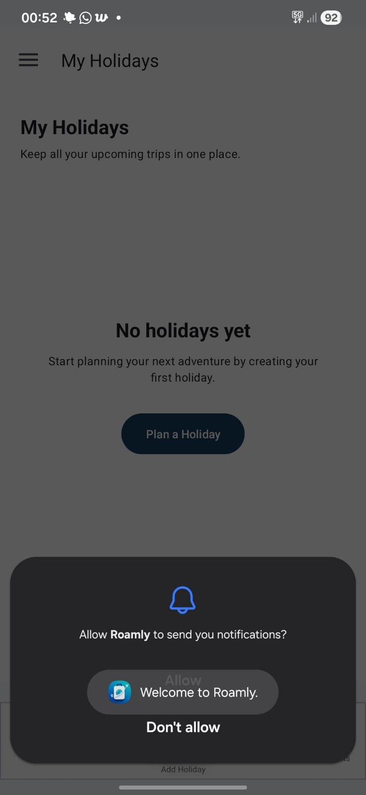

*Figure 1: Roamly running on the physical Android test device after successful Google authentication. The screenshot provides the starting point for the final physical-device evidence and confirms access to the authenticated application interface.*

________________________________________

## Final POE Requirements

The table below maps the main Final POE technical requirements to the completed Roamly implementation. It is intended as a quick assessment guide before the more detailed technical sections that follow.

| Final POE Requirement | Roamly Implementation | Status |
|---|---|---|
| Single Sign-On | Google authentication is validated through the Roamly backend before protected access is granted | Implemented |
| Biometric Authentication | Android's native biometric framework is used for fingerprint authentication on supported devices | Implemented |
| Application Settings | Preferred language, home currency and reminder preferences are persisted through DataStore and synchronised where supported | Implemented |
| Custom REST API | Android communicates with a Node.js, TypeScript and Express backend | Implemented |
| Relational Database | Structured application data is persisted in Azure SQL through Prisma ORM | Implemented |
| Offline Mode | Room stores supported structured data locally while connectivity is unavailable | Implemented |
| Automatic Synchronisation | WorkManager synchronises pending supported changes after connectivity returns | Implemented |
| Real-Time Notifications | Firebase Cloud Messaging delivers Roamly push notifications | Implemented |
| Multi-language Support | English, Afrikaans, isiZulu and isiXhosa resources with application locale switching | Implemented |
| Blob Storage | Uploaded travel-document files are stored in Azure Blob Storage | Implemented |
| NoSQL Integration | Azure Table Storage stores authenticated Roamly travel notes | Implemented |
| Physical Device Support | Final features were verified on a Samsung Galaxy S22 running Android 16 | Verified |
| Continuous Integration | GitHub Actions runs Android unit tests and builds the debug APK | Verified |

________________________________________

## Purpose and Design Considerations

Roamly was originally designed to reduce the need for travellers to depend on multiple unrelated applications while planning and preparing for a trip.

The Part 1 research identified several related travel needs that could be combined within one platform:

- Centralised holiday information
- Chronological itinerary planning
- Packing and document tools
- Currency support
- Travel reminders and countdowns
- A secure personalised user experience

The final design therefore prioritises more than feature quantity. It also focuses on how the features work together.

Key design considerations include:

- **Centralisation** so that related trip information remains accessible from one application
- **Security** so that user-owned cloud data is associated with authenticated accounts
- **Offline resilience** because travel often involves unreliable or unavailable connectivity
- **Persistence** so that Settings and supported travel data survive application restarts
- **Separation of responsibilities** between the Android interface, repositories, local persistence, API and cloud storage
- **Maintainability** through modular features, repositories and testable components
- **Accessibility** through support for multiple South African languages
- **Production readiness** through physical-device testing, automated CI checks and release artefacts

________________________________________

## Final System Architecture

The Part 2 prototype primarily followed a three-tier client-server structure:

```text
Android Application
        |
        v
Custom REST API
        |
        v
Azure SQL Database
```

That structure remains important, but the Final POE expands it because not all data now follows the same path.

Local Settings use DataStore, offline structured data uses Room, reconnection tasks use WorkManager, file content is stored in Azure Blob Storage and NoSQL travel notes are stored in Azure Table Storage.

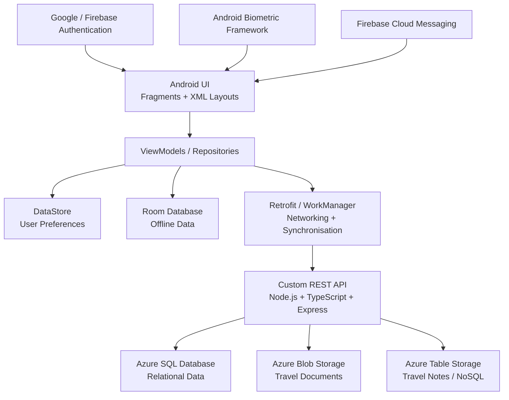

The team also created a simplified architecture diagram for the demonstration video. It focuses specifically on the main online/offline data path:

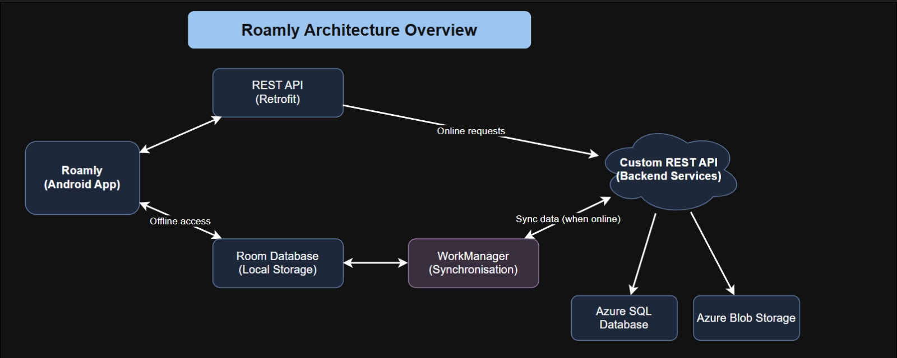

*Figure 2: Simplified Roamly architecture overview showing the Android client, Retrofit communication, Room local storage, WorkManager synchronisation, the custom REST API, Azure SQL and Azure Blob Storage. The Mermaid diagram above expands this view by also showing DataStore, Azure Table Storage, Firebase services and Android biometrics.*

### Android Presentation Layer

The Android application is developed using Kotlin, Fragments and XML layouts.

The final presentation layer contains interfaces for:

- Home / Dashboard
- Holidays
- Itinerary
- Packing
- Travel Documents
- Currency Converter
- Reminders and Notifications
- Settings
- Authentication

Using separate feature fragments keeps the interface responsibilities divided rather than placing the complete application inside one Activity.

### Application and Repository Layer

ViewModels and repositories separate interface state from local persistence and network communication.

This reduces direct coupling between screens and data sources. A screen can therefore work through a repository without needing to know whether the underlying information comes from DataStore, Room or the REST API.

### Local Persistence Layer

Roamly uses two local persistence technologies because they solve different problems.

**DataStore** is used for lightweight Settings preferences such as:

- Preferred language
- Home currency
- Reminder preference

**Room** is used for structured local data that must remain available for supported offline functionality.

### Networking and Synchronisation Layer

Retrofit connects the Android application to the custom REST API.

WorkManager supports background synchronisation for supported locally stored data after network connectivity becomes available again.

This is especially important for travel use because a user can make changes while offline without needing to recreate the same data once the device reconnects.

### Cloud Layer

The final cloud implementation includes:

- Azure App Service for the custom backend
- Azure SQL Database for relational application data
- Azure Blob Storage for uploaded travel-document files
- Azure Table Storage for NoSQL travel notes
- Google / Firebase services for authentication
- Firebase Cloud Messaging for push notifications

________________________________________

## Authentication and Security

Google Single Sign-On provides the primary external identity mechanism.

After Google authentication, the identity token is passed to the custom backend where it is validated before the Roamly application session is established. Backend-protected resources are associated with the authenticated user so that one user's travel information is not exposed to another user through the API.

The Final POE also adds native Android biometric authentication.

Biometric verification is handled by Android's protected biometric framework rather than by Roamly itself. The application therefore does not receive or store the user's fingerprint template.

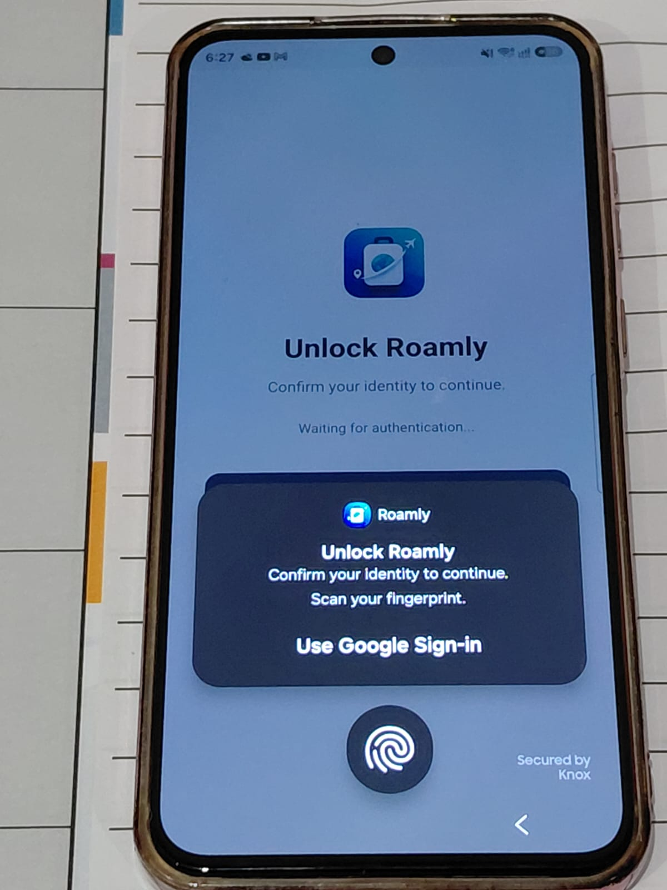

*Figure 3: External photograph of the physical test phone showing Android's protected fingerprint prompt over the Roamly Unlock screen. Android blocks normal screenshots of this system dialog, so an external photograph was used to provide direct evidence that Roamly invokes the native biometric framework.*

________________________________________

## Application Settings and Preference Persistence

The Settings implementation was expanded significantly during the Final POE.

Users can manage preferences including:

- Preferred application language
- Home currency
- Travel-reminder preference

Android DataStore is used to persist these lightweight preferences locally.

The repository also supports migration from the earlier Part 2 preference file, which allows the project to move to DataStore without simply discarding the previous preference structure.

Settings are also synchronised through the authenticated `/api/settings` endpoint. This connects the device preference layer with the user's Roamly account while still keeping local persistence available.

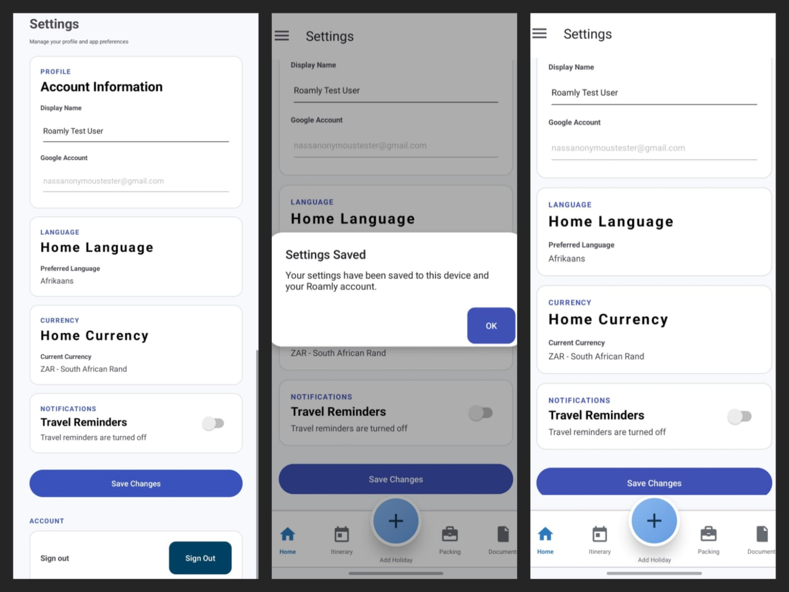

*Figure 4: Settings persistence evidence showing the saved preference values remaining available after the application was reopened. This verifies that the preference state is not limited to the current screen session.*

________________________________________

## Home Currency Integration

The Home Currency preference is not stored only for display inside Settings.

When the Currency Converter opens, the saved Home Currency is automatically applied as the source currency. This creates a direct connection between two separate areas of the application and reduces repeated configuration for the user.

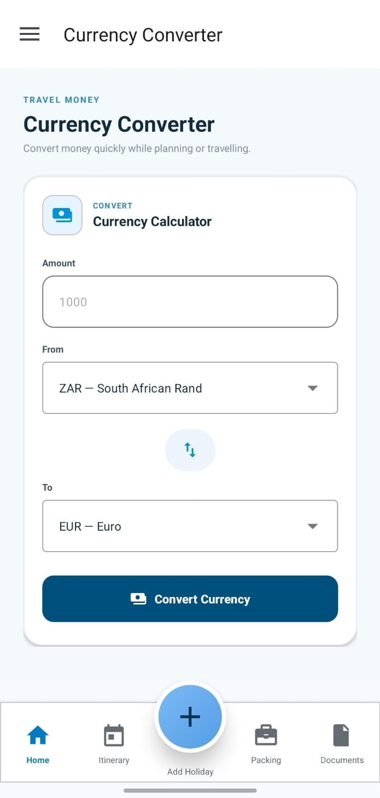

*Figure 5: Currency Converter using the Home Currency previously saved in Settings. The screenshot demonstrates cross-feature use of the persisted preference rather than an isolated Settings value.*

________________________________________

## Offline Functionality and Synchronisation

Roamly uses Room to provide structured local persistence for supported features.

The final offline test used Packing because it provides a clear way to verify creation, item state and progress while network connectivity is unavailable.

A list named `Offline Test Packing` was created while offline together with the items `Offline Test Passport` and `Offline Test Hotel Accommodation`. One item was marked as packed and the local interface continued to display the list and its `1 of 2 packed` state.

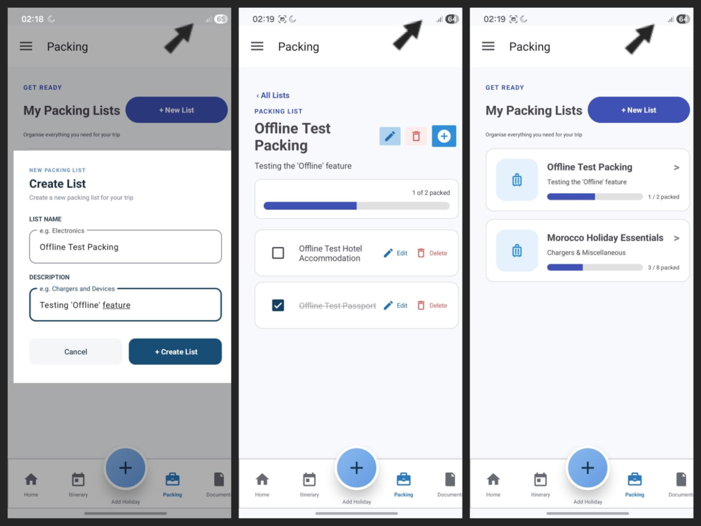

*Figure 6: Packing data created and retained while the physical Android device had no network connectivity. The visible items and packing progress demonstrate that the supported feature remained usable from local Room storage.*

After connectivity was restored, the same data remained visible in the application.

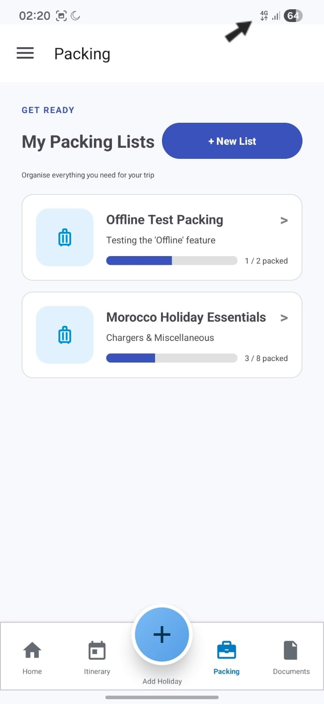

*Figure 7: The offline-created Packing list still available after reconnection, showing that the locally stored state was retained rather than replaced or lost.*

The cloud-side verification then confirmed that the same list and items had reached Azure SQL with the expected packed states.

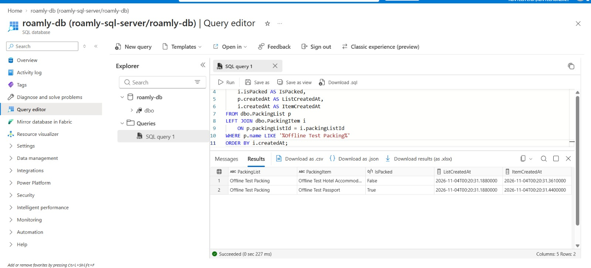

*Figure 8: Azure SQL query results showing `Offline Test Packing`, `Offline Test Passport` and `Offline Test Hotel Accommodation` after reconnection. The stored packed-state values match the earlier physical-device test, providing direct evidence of offline-to-cloud synchronisation.*

________________________________________

## REST API and Azure SQL Integration

The custom REST API remains the primary communication layer between the Android application and the cloud.

It is developed using Node.js, TypeScript and Express, while Prisma ORM provides the relational data-access layer for Azure SQL.

The backend is responsible for areas including:

- Authenticated requests
- User-specific authorisation
- Holiday CRUD operations
- Itinerary data
- Packing data
- Reminder data
- Settings synchronisation
- Travel Document metadata
- Offline-to-cloud synchronisation
- Azure service integration

A final API round-trip test created the Final POE Cape Town holiday in the Android application.

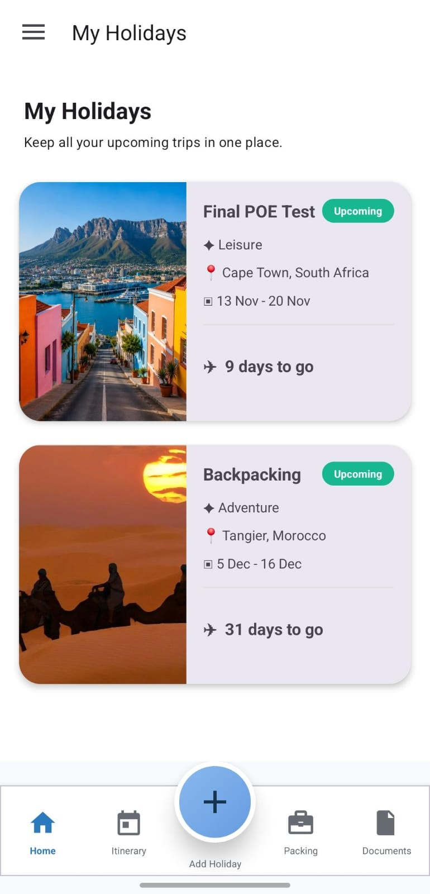

*Figure 9: The Final POE holiday displayed in Roamly after creation. This screenshot provides the Android-side record that is compared with the matching cloud data.*

Azure SQL returned the corresponding record with the expected Cape Town / South Africa destination and 13–20 November 2026 dates.

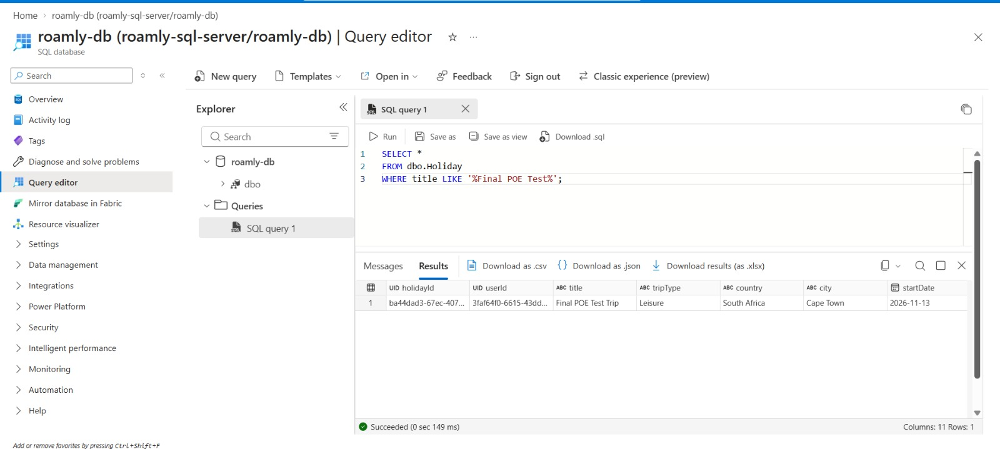

*Figure 10: Azure SQL query result showing the matching Final POE holiday record, including Leisure trip type, South Africa country, Cape Town city and the expected start date.*

The detailed testing report includes the second Azure screenshot showing the matching end date.

________________________________________

## Real-Time Notifications

Firebase Cloud Messaging is integrated to provide real-time push-notification capability.

The final Android project includes `RoamlyMessagingService`, which receives Firebase notification or data payloads and displays them through Android's notification system when notification permission is available.

Final physical-device testing confirmed successful delivery.

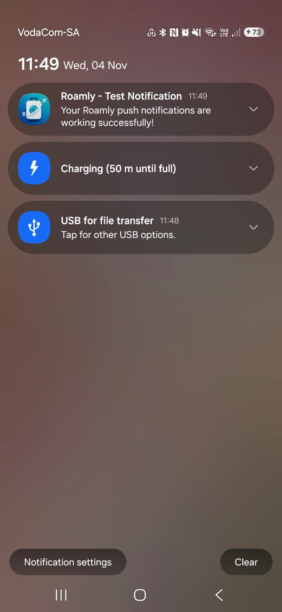

*Figure 11: Android notification shade showing the delivered `Roamly - Test Notification` message. The notification appears with the Roamly icon and confirms that the Firebase message reached the physical device.*

________________________________________

## Multi-Language Support

The completed Android project contains language resources for:

- English
- Afrikaans
- isiZulu
- isiXhosa

The corresponding Android resource directories are:

```text
values/
values-af-rZA/
values-zu/
values-xh/
```

The Settings implementation maps the displayed language names to the language codes `en`, `af`, `zu` and `xh`.

The selected locale is applied using `AppCompatDelegate.setApplicationLocales(...)`, while the chosen language preference is retained through the Settings persistence layer.

The final evidence uses Afrikaans because it provides a clear visual example of the localisation result across multiple interface elements.

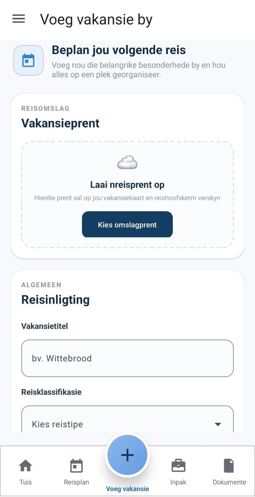

*Figure 12: Add Holiday interface displayed in Afrikaans. The translated heading, explanatory text, field labels, action button and bottom-navigation items show that the locale change affects the broader screen rather than a single isolated label.*

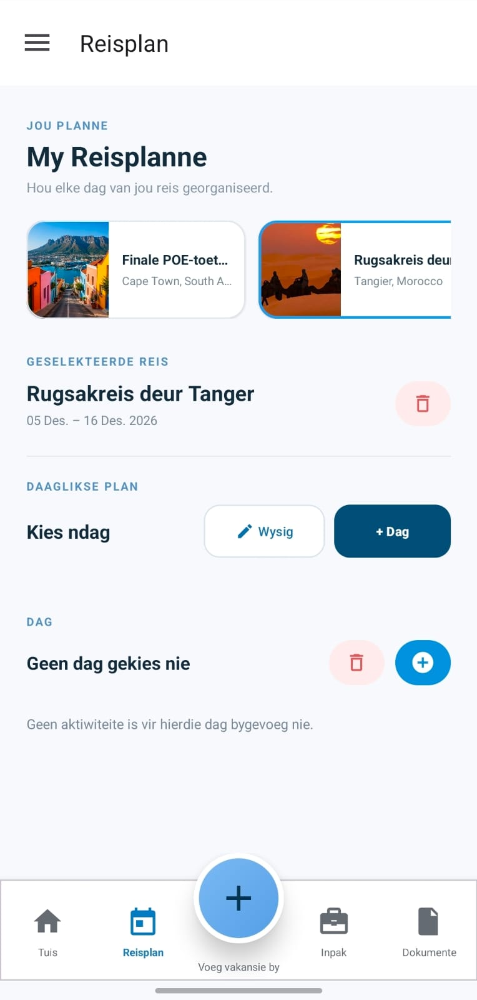

*Figure 13: Itinerary interface still displayed in Afrikaans after the application was reopened. The translated headings, controls and navigation provide evidence that the selected language preference persisted across restart.*

________________________________________

## Travel Documents and Azure Blob Storage

Roamly supports travel-document upload and management.

The final test uploaded:

- Document Name: `Boarding Pass`
- Document Type: `Flight`
- File: `Morocco Trip - Boarding Pass.pdf`
- Notes: `Boarding Pass for outbound flight`

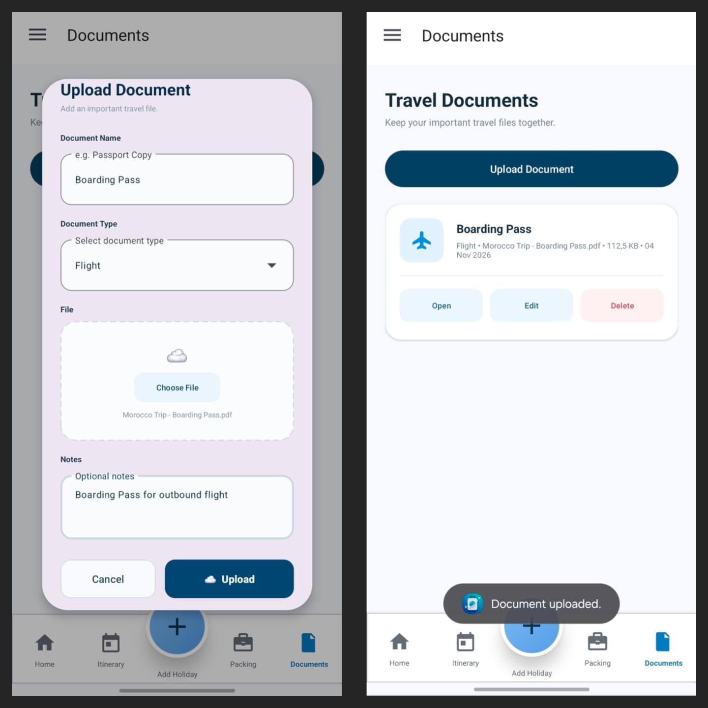

*Figure 14: Travel Documents interface showing the Boarding Pass upload and the successfully created document record inside Roamly.*

The final implementation separates the actual file from its structured metadata.

TravelDocument metadata is stored through the backend and Azure SQL, while the PDF content is stored in Azure Blob Storage.

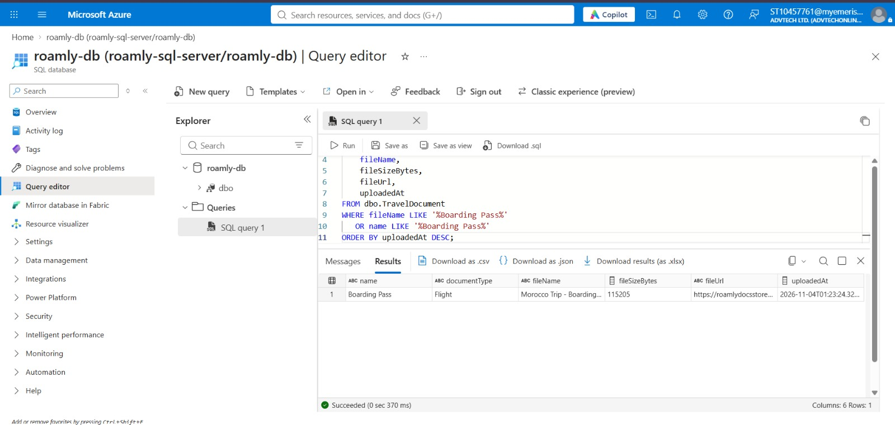

*Figure 15: Azure SQL query result for the Boarding Pass metadata, including the document type, PDF file information, stored file URL and upload timestamp.*

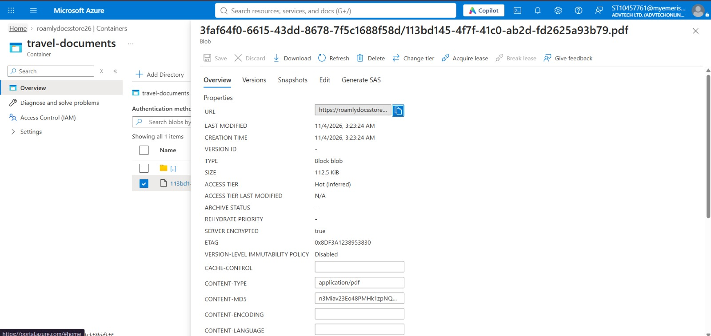

*Figure 16: Matching PDF object in the Azure Blob Storage `travel-documents` container. The Blob properties identify the object as a PDF block blob and show the stored size and server-encrypted state.*

________________________________________

## NoSQL Integration

Roamly uses **Azure Table Storage** to satisfy the Final POE NoSQL requirement.

The final backend exposes authenticated `/api/travel-notes` routes. Travel notes are stored in the `RoamlyTravelNotes` table and are associated with the authenticated user through the storage key structure.

Stored note data includes:

- Title
- Content
- Category
- Tags
- Created timestamp
- Updated timestamp

The final evidence uses a record named `POE NoSQL Test`.

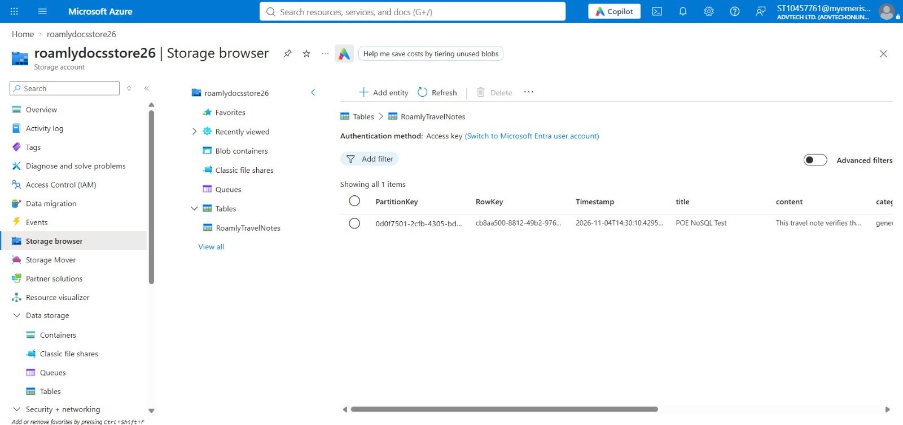

*Figure 17: Azure Storage Browser showing the `POE NoSQL Test` entity in the `RoamlyTravelNotes` table. The visible key fields, title and content provide direct evidence that the final NoSQL record was stored successfully.*

Additional property evidence is included in the detailed testing report.

________________________________________

# User-Defined Features

Roamly contains custom functionality beyond the minimum technical requirements.

The Part 1 research and design work identified several travel-specific ideas, including centralised trip management, interactive itineraries, practical travel tools, automated reminders and a personalised experience.

The lecturer later clarified that the team did not need to invent two completely new features if suitable custom functionality had already been developed. Instead, the README needed to clearly identify which implemented functionality would be treated as User-Defined Features 4 and 5.

## User-Defined Feature 4 - Travel Management Toolkit

Feature 4 is designated as the **Travel Management Toolkit**.

It brings together practical preparation tools rather than treating Packing and Travel Documents as unrelated screens.

The toolkit includes:

- Packing-list creation
- Packing-item management
- Packed/unpacked state
- Automatic packing progress
- Travel checklist functionality
- Travel-document management
- Azure Blob-backed document storage
- Room-backed offline Packing support
- Reconnection synchronisation

This feature supports the original Roamly goal of reducing the number of separate tools a traveller needs while preparing for a trip.

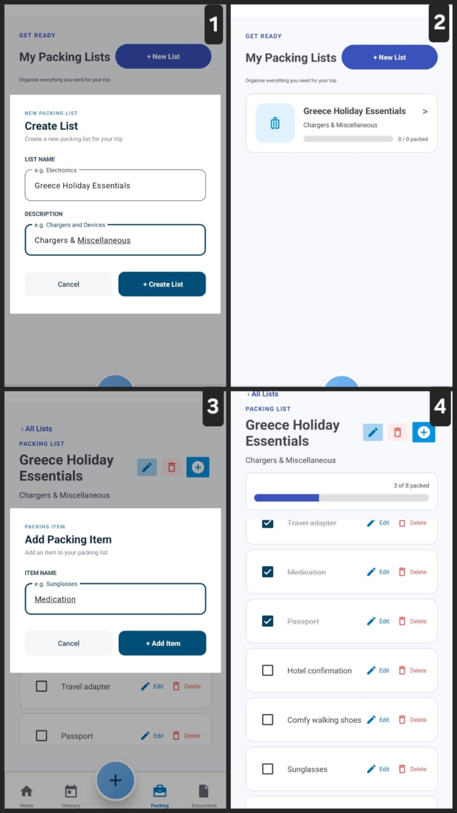

*Figure 18: Final Travel Management Toolkit evidence showing creation of a realistic packing list, multiple packing items and the calculated packed-item progress. The sequence demonstrates that the feature supports more than a static checklist.*

## User-Defined Feature 5 - Automated Travel Reminders and Countdowns

Feature 5 is designated as **Automated Travel Reminders and Countdowns**.

It provides time-sensitive travel support by connecting reminders with upcoming holidays.

Users can work with reminder information such as:

- Title
- Associated holiday
- Date
- Time
- Description
- Enabled/disabled state

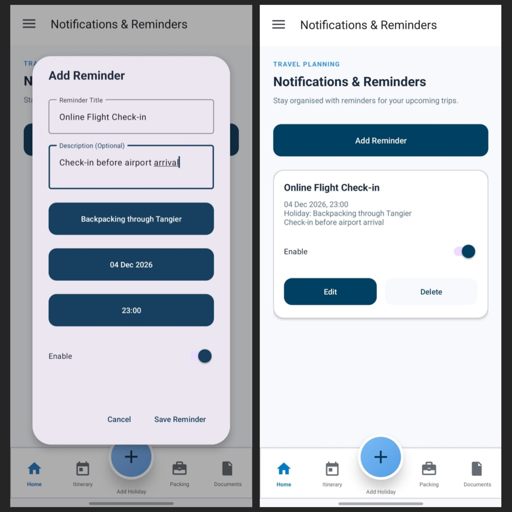

*Figure 19: `Online Flight Check-in` reminder displayed with its date/time, associated holiday, description and enabled state.*

Holiday cards also calculate countdown information from future travel dates.

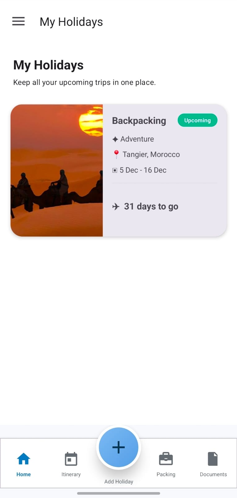

*Figure 20: Upcoming Backpacking holiday displaying its calculated `31 days to go` value, providing the countdown component of User-Defined Feature 5.*

________________________________________

## Additional Custom Functionality

Although Features 4 and 5 are the two features explicitly identified for the final rubric, Roamly retains additional custom functionality originating from the Part 1 design.

### Centralised Holiday Management

Users can create and manage holidays containing trip names, classifications, destinations, dates and related accommodation or flight information.

### Interactive Day-to-Day Itinerary

The itinerary area allows trip information to be organised chronologically by day so that users can manage planned activities in the context of a specific holiday.

### Currency Conversion

The Currency Converter gives travellers a practical utility inside the same application used to manage the rest of their trip.

### Personalised Travel Experience

Authenticated user-owned data, persistent Settings, reminders and language preferences create a more personalised experience than a static travel-planning interface.

________________________________________

## Version Control and Collaborative Development

Roamly was developed collaboratively using Git and GitHub.

The team used separate feature branches so that allocated functionality could be developed and tested before being merged into the shared `main` branch.

The typical workflow was:

```text
main
  |
  +--> team-member feature branch
         |
         +--> implementation
         +--> local testing
         +--> commit and push
         +--> pull request
         |
         v
        main
```

This approach provided:

- Traceable contribution history
- Isolated feature development
- Safer integration
- Pull-request review opportunities
- A stable final shared branch

The Settings work followed this same process and was merged into `main` only after local tests and build verification had passed.

________________________________________

## GitHub Actions and Continuous Integration

GitHub Actions provides automated verification outside the developer's local Android Studio environment.

The final workflow is stored in:

```text
.github/workflows/android-tests.yml
```

It runs when code is pushed to `main` and when a pull request targets `main`.

The workflow:

1. Checks out the repository
2. Sets up Java 17
3. Sets up Gradle
4. Makes the Gradle wrapper executable
5. Runs the Android unit tests with `./gradlew testDebugUnitTest`
6. Builds the Android debug APK with `./gradlew assembleDebug`

This means the repository no longer relies only on manual local `BUILD SUCCESSFUL` results. The same configured test/build tasks are repeated in GitHub's hosted CI environment.

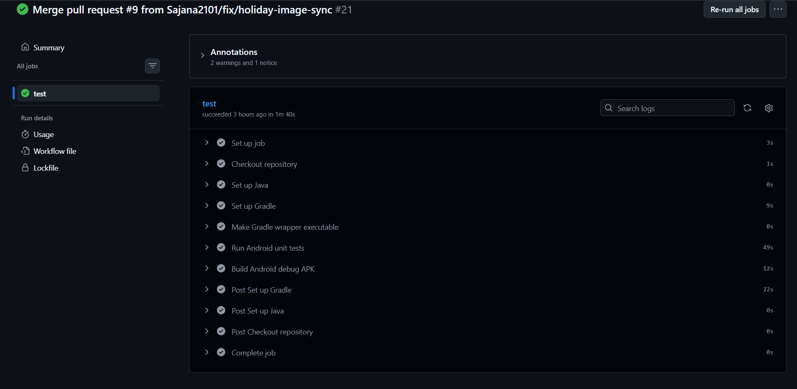

*Figure 21: Final Android Tests workflow on `main` showing the successful `Run Android unit tests` and `Build Android debug APK` steps in the same GitHub Actions job. This confirms automated verification of both testing and compilation.*

________________________________________

## Testing Procedures and Quality Assurance

Roamly uses several forms of testing because one test method cannot verify every requirement.

The Final POE combines:

- Automated Android unit tests
- Backend and API testing
- Integration testing
- Offline and reconnection testing
- Physical-device functional testing
- UI and input-validation testing
- GitHub Actions verification
- Final integrated regression review

The detailed test report follows a repeatable structure so that each important result identifies the objective, preconditions, test steps, expected result, actual result and supporting evidence.

**[View the Final POE Testing Documentation](docs/TESTING.md)**

### Automated Settings Testing

The Settings-specific test suite verifies persistence and language mapping.

The final report recorded:

- 8 tests
- 0 failures
- 0 ignored tests
- 100% success

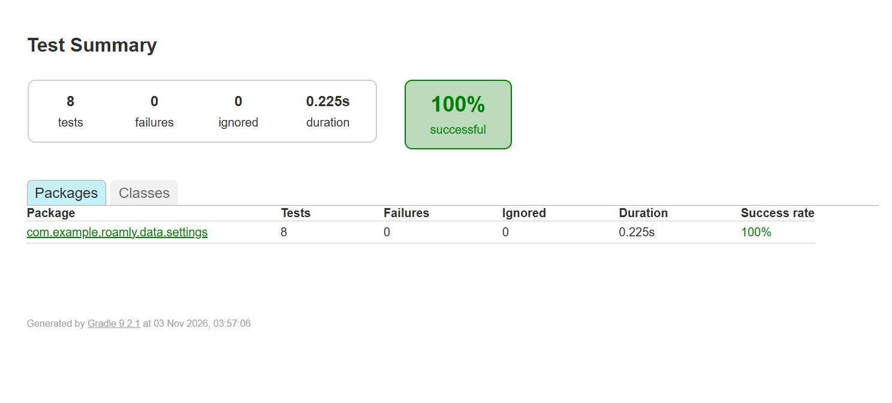

*Figure 22: Gradle test report confirming that all eight Settings-specific tests completed successfully with no failures or ignored tests.*

________________________________________

## Lecturer Feedback and Iteration

The Final POE was reviewed against the feedback received during the earlier project phases rather than treating each submission as completely separate work.

### Part 1 - Research, Planning and Design

The Part 1 lecturer feedback mainly identified:

- Referencing issues in parts of the research
- Missing table and figure captions
- A need for stronger discussion of specific application strengths and weaknesses
- A need for clearer discussion of user-interface strengths and weaknesses
- Insufficient emphasis on the application's innovative features
- Offline mode with synchronisation had not been explained
- Some planning/design visuals contained more detail than was necessary

The most relevant application-development feedback was addressed directly in the Final POE.

Offline mode and synchronisation are now explained as separate Room and WorkManager responsibilities and are supported by both physical-device and Azure SQL evidence.

The final technical documentation also uses figure captions consistently and explicitly identifies the implemented User-Defined Features 4 and 5 rather than leaving the innovative/custom functionality implicit.

### Part 2 - Application Prototype

The Part 2 prototype achieved full marks and received the written feedback:

*"Well done!"*

Because the Part 2 submission had already met the assessment requirements for that phase, there were no corrective technical changes prescribed by the lecturer.

The Final POE therefore focused on extending the successful prototype with the additional final requirements, cloud integrations, offline capability, testing and publication-readiness work.

________________________________________

## Google Play Store and Production Readiness

The final Android application was prepared for assessment and publication-readiness evidence rather than remaining only as a development build inside Android Studio.

Final Android configuration includes:

| Item | Final Value |
|---|---|
| Application Version | `1.0` |
| Version Code | `1` |
| Minimum SDK | `24` |
| Target SDK | `36` |
| Physical Test Device | Samsung Galaxy S22 (`SM-S901E/DS`) |
| Test Android Version | Android 16 |

Final production evidence includes:

- Final application icon
- Signed production APK
- Promotional Play Store screenshots
- Successful final GitHub Actions build
- Physical-device verification

**Signed production APK:** `app-release.apk`

**Promotional screenshots:** [View the Play Store readiness assets](docs/play-store/)

________________________________________

## Formal Release Notes

A separate release-notes document records the functional and technical changes introduced after the Part 2 prototype.

**[View the Final POE Release Notes](RELEASE_NOTES.md)**

________________________________________

## Final Demonstration Video

The earlier Part 2 demonstration link is retained in the historical section of this README.

The final narrated demonstration is intended to show the completed application running on a physical Android device and to bring together the most important Final POE requirements in one walkthrough.

The final demonstration covers areas including:

- Google Single Sign-On
- Biometric verification
- Settings and persistence
- REST API communication
- Offline operation
- Synchronisation after reconnection
- Cloud/database interaction
- Firebase notifications
- Multilingual functionality
- User-Defined Feature 4
- User-Defined Feature 5

**Final POE Demonstration Video:** **[INSERT FINAL UNLISTED VIDEO URL BEFORE SUBMISSION]**

________________________________________

## AI Usage

A separate AI Usage Report will document the permitted generative-AI assistance used during the Final POE.

The report will remain within the required maximum word count and will describe the actual ways AI assistance was used together with the required supporting evidence.

**[View the AI Usage Report](docs/AI_USAGE.pdf)**

________________________________________

## Final POE Supporting Documents

The supporting files below separate detailed evidence from the main technical README so that the README remains readable while still linking to the underlying proof.

| Document / Artefact | Purpose |
|---|---|
| [Testing Documentation](docs/TESTING.md) | Detailed manual, automated, integration and physical-device testing |
| [Testing Report PDF](docs/TESTING.pdf) | PDF version of the final testing report |
| [Formal Release Notes](RELEASE_NOTES.md) | Functional and technical changes introduced after Part 2 |
| [Play Store Assets](docs/play-store/) | Promotional screenshots prepared for publication readiness |
| `app-release.apk` | Signed production APK supplied as a final release artefact |
| [AI Usage Report](docs/AI_USAGE.pdf) | Final AI-use declaration and supporting evidence |

________________________________________

## Concluding the Final POE

The Final POE represents the completion and evaluation phase of Roamly.

The final implementation retains the successful core prototype while strengthening:

- Authentication and application security
- Offline resilience
- Persistent user preferences
- Cloud integration
- Travel Document storage
- NoSQL data storage
- Notification functionality
- Localisation
- Automated testing
- Physical-device verification
- Collaborative DevOps practices
- Publication readiness

These additions continue the original Part 1 goal of providing travellers with a centralised mobile application for organising holidays, itineraries, packing, documents, reminders, currency preferences and related travel information.
________________________________________
## References
Bernard, N. B., 2025 . Understanding the 3-tier architecture. [Online] 
Available at: https://code-garage.com/en/blog/understanding-3-tier-architecture
[Accessed 21 September 2026 ].

Gillis, A. S., 2024. What is a 3-tier application architecture?. [Online] 
Available at: https://www.techtarget.com/it-infrastructure/definition/What-is-a-3-tier-application-architecture
[Accessed 21 September 2026 ].

IBM, 2021. What is three-tier architecture?. [Online] 
Available at: https://www.ibm.com/think/topics/three-tier-architecture
[Accessed 21 September 2026 ].

Kerr, K., 2026 . GitHub for Beginners: Getting started with GitHub Actions. [Online] 
Available at: https://github.blog/developer-skills/github/github-for-beginners-getting-started-with-github-actions/
[Accessed 21 September 2026 ].

Microsoft, 2026. Configure an App Service app. [Online] 
Available at: https://learn.microsoft.com/en-us/azure/app-service/configure-common?tabs=portal
[Accessed 21 September 2026 ].


