# Roamly Final POE Testing Documentation

## 1. Purpose

This document records the testing completed for the Roamly Final POE. It provides structured evidence that the application features, integrations and advanced Final POE requirements were tested through automated testing, integration testing and physical-device testing.

The report should be read together with the main `README.md`, the formal release notes and the final demonstration video.

________________________________________

## 2. Testing Approach

Roamly is tested using a combination of:

- Android unit testing
- Backend and REST API testing
- Integration testing
- Physical Android device testing
- Offline and reconnection testing
- User-interface and input-validation testing
- Regression testing
- GitHub Actions continuous-integration verification

(Screenshots used as testing evidence are stored under `docs/evidence/` and are embedded directly into the relevant sections of this report.)

________________________________________

## 3. Test Environment

The test environment is recorded so that the final results can be understood in context and reproduced where necessary. It identifies the main technologies, cloud services, build tools and physical hardware used during the Final POE verification.

| Item | Test Environment |
|---|---|
| Application | Roamly Android travel-planning application |
| Android Language | Kotlin |
| Backend | Node.js, TypeScript and Express |
| Cloud API | Microsoft Azure App Service |
| Relational Database | Azure SQL Database |
| File Storage | Azure Blob Storage |
| Local Persistence | Room and DataStore |
| Authentication | Google SSO / Firebase and Roamly backend authentication |
| Notifications | Firebase Cloud Messaging and Android notifications |
| Build System | Gradle |
| Version Control | Git and GitHub |
| Continuous Integration | GitHub Actions |
| Physical Device | Samsung Galaxy S22 (`SM-S901E/DS`) |
| Android Version | Android 16 |
| Final Test Date | 6 November 2026 |

________________________________________

## 4. Test ID Key

The test IDs are shortened only to make the final report easier to reference.

| Prefix | Meaning |
|---|---|
| `AUTH` | Google authentication / SSO |
| `BIOMETRIC` | Biometric authentication |
| `SETTINGS` | Settings and DataStore persistence |
| `API` | REST API and cloud communication |
| `OFFLINE` | Offline Room functionality |
| `SYNC` | Offline-to-cloud synchronisation |
| `NOTIFY` | Real-time notifications / Firebase Cloud Messaging |
| `LANGUAGE` | Multi-language functionality |
| `BLOB` | Azure Blob Storage |
| `NOSQL` | NoSQL storage |
| `FEATURE4` | User-Defined Feature 4 |
| `FEATURE5` | User-Defined Feature 5 |
| `CI` | GitHub Actions / Continuous Integration |
| `BUILD` | Gradle build verification |
| `DEVICE` | Physical-device execution |
| `REGRESSION` | Final end-to-end regression testing |

________________________________________

## 5. Test Status Definitions

The status terms below are used consistently throughout the report so that each test result can be understood at a glance. A PASS indicates that the final observed behaviour matched the stated expectation, while FAIL or BLOCKED would identify an unresolved problem that still required attention.

| Status | Meaning |
|---|---|
| PASS | Test completed and the actual result matched the expected result. |
| FAIL | Test completed but the actual result did not match the expected result. |
| BLOCKED | The test could not be completed because of an external dependency or unresolved issue. |

________________________________________

## 6. Final POE Test Summary

The summary below provides a single view of the Final POE verification. The detailed sections that follow explain how each result was obtained, what data was used and which screenshot or automated result supports the final status.

| Test ID | Feature / Requirement | Test Type | Status |
|---|---|---|---|
| AUTH-01 | Google SSO authentication | Physical device / integration | PASS |
| BIOMETRIC-01 | Biometric authentication | Physical device | PASS |
| SETTINGS-01 | Settings save to device and Roamly account | Physical device / integration | PASS |
| SETTINGS-02 | Settings persist after application restart | Physical device | PASS |
| SETTINGS-03 | Saved home currency integrates with Currency Converter | Physical device / integration | PASS |
| SETTINGS-04 | Settings persistence and language mapping automated tests | Automated unit tests | PASS |
| API-01 | Authenticated REST API communication | Integration | PASS |
| OFFLINE-01 | Supported application action while offline | Physical device / integration | PASS |
| SYNC-01 | Application state after network reconnection | Physical device / integration | PASS |
| NOTIFY-01 | Real-time FCM push notification received on device | Physical device / integration | PASS |
| LANGUAGE-01 | Language switching | Physical device | PASS |
| LANGUAGE-02 | Selected language persists after application restart | Physical device | PASS |
| BLOB-01 | Travel-document upload and retrieval using Blob Storage | Integration / physical device | PASS |
| NOSQL-01 | NoSQL data write and read | Integration | PASS |
| FEATURE4-01 | User-Defined Feature 4 - Travel Management Toolkit | Functional / physical device | PASS |
| FEATURE5-01 | User-Defined Feature 5 - Automated Reminders and Countdowns | Functional / physical device | PASS |
| CI-01 | GitHub Actions automated build and tests | CI / automated | PASS |
| BUILD-01 | Android application build | Automated build | PASS |
| DEVICE-01 | Application runs on physical Android device | Physical device | PASS |
| REGRESSION-01 | Final integrated regression review after all branches were merged | Regression / integration review | PASS |

________________________________________

# 7. Detailed Test Cases

## AUTH-01 - Google Single Sign-On

**Feature:** Google SSO  
**Objective:** Verify that a user can authenticate with a supported Google account and enter the Roamly application.

**Preconditions:**

- The physical Android device has internet connectivity
- Firebase / Google OAuth configuration is valid
- The Roamly backend is available

**Test Steps:**

1. Launch Roamly
2. Open the Login screen
3. Select **Continue with Google**
4. Select the test Google account from the Android account chooser
5. Allow the secure sign-in process to complete
6. Verify that the authenticated Roamly interface opens

**Expected Result:**

Google authentication should complete successfully and the authenticated Roamly interface should be displayed.

**Actual Result:**

The Google SSO flow opened correctly, displayed the Android Google account chooser, completed the secure sign-in process and opened the authenticated Roamly application.

**Status:** PASS

**Evidence Screenshots:**

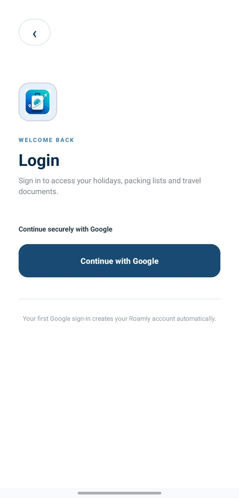

*Figure 1: Roamly Login screen showing the Continue with Google authentication option.*

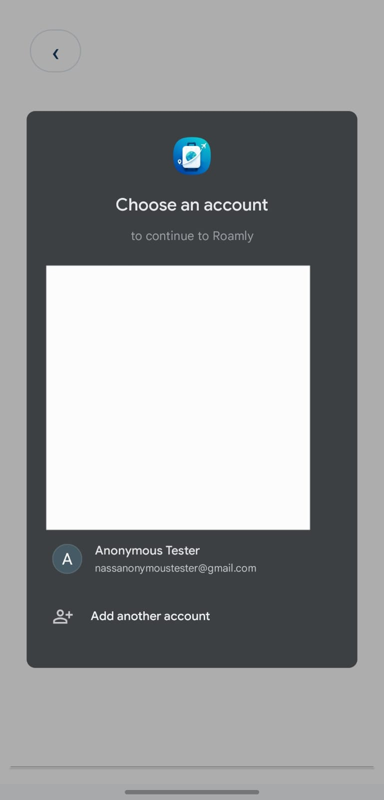

*Figure 2: Android Google account chooser displayed for Roamly authentication.*

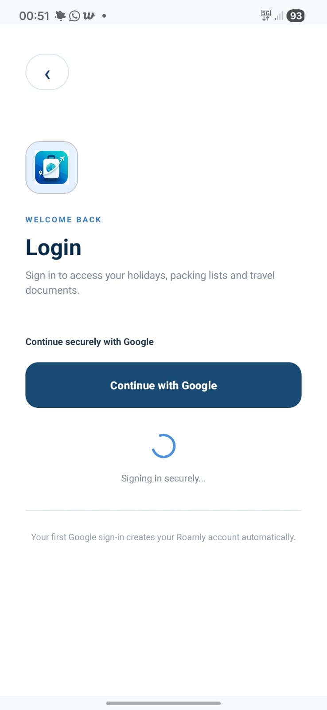

*Figure 3: Roamly processing the selected Google account through the secure sign-in flow.*

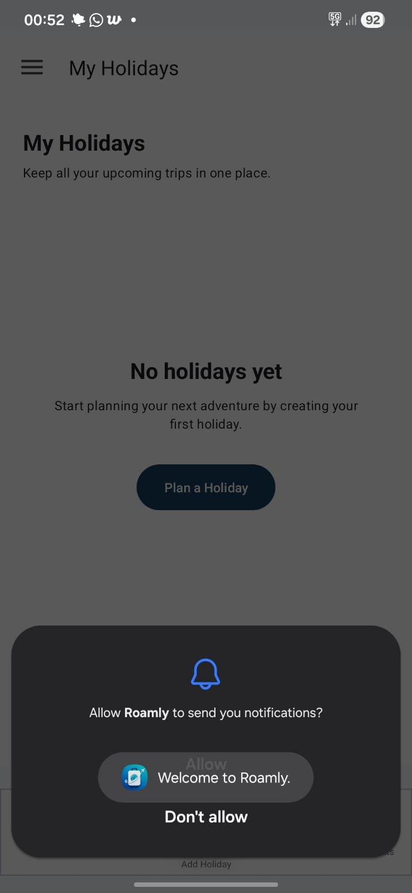

*Figure 4: The authenticated Roamly Home screen displayed after Google Single Sign-On.*

________________________________________

## BIOMETRIC-01 - Biometric Authentication

**Feature:** Biometric authentication  
**Objective:** Verify that Roamly invokes the native Android biometric authentication flow on the physical Android device and that the application provides an appropriate alternative authentication path.

**Why this test matters:**

Biometric authentication is one of the advanced Final POE requirements. The test therefore verifies the actual native Android security prompt rather than only checking that a biometric button exists in the Roamly interface.

**Preconditions:**

- The physical device supports biometric authentication
- A fingerprint is enrolled on the device
- Roamly is installed and able to reach the Unlock Roamly screen

**Test Steps:**

1. Launch Roamly
2. Reach the **Unlock Roamly** screen
3. Start biometric authentication
4. Verify that Android displays its protected fingerprint prompt
5. Complete or cancel the prompt
6. Confirm that Roamly handles the result and still provides Google Sign-In as the alternative path

**Expected Result:**

Roamly should invoke Android's native biometric framework. The fingerprint prompt should be displayed by the operating system and the application should not attempt to store or reproduce biometric data itself.

**Actual Result:**

The physical Android device displayed the protected native fingerprint prompt over the Roamly Unlock screen. The prompt identified Roamly, requested the user to scan a fingerprint and showed the device-level biometric indicator. The application also retained the **Use Google Sign-in** option as an alternative authentication path.

Because Android protects this system dialog from normal screenshots, the final evidence was captured externally using a second device. This provides direct proof that the native Android biometric interface was invoked rather than a custom Roamly imitation.

**Status:** PASS

**Evidence Screenshot:**

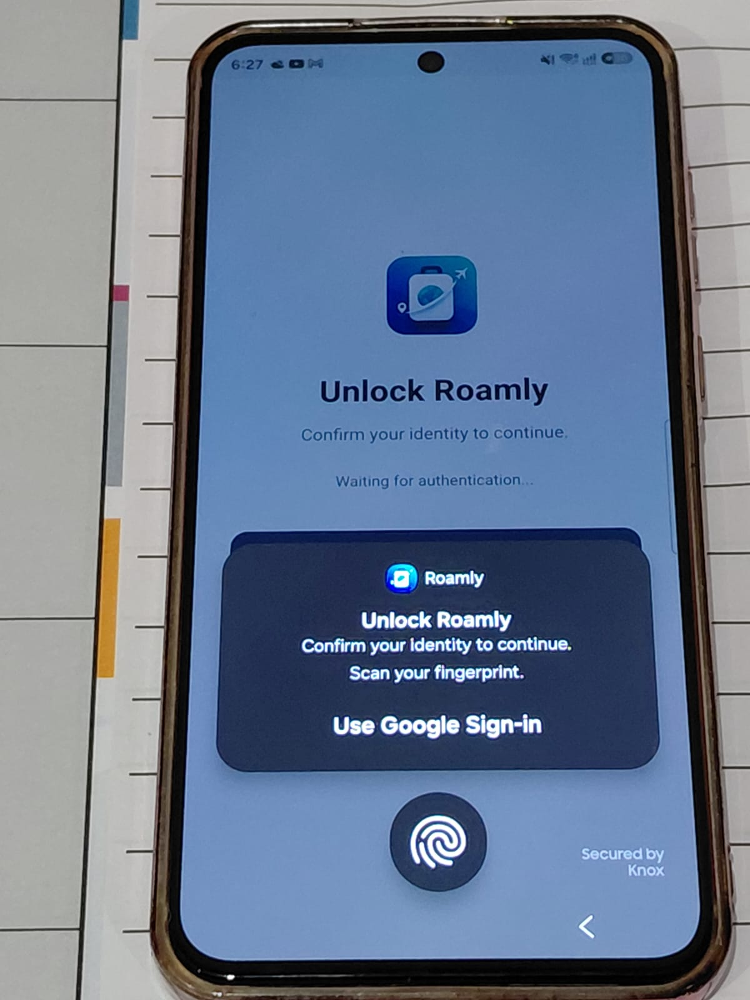

*Figure 5: External photograph of the physical Roamly test device showing Android's protected fingerprint prompt over the Unlock Roamly screen. The image demonstrates that the application invokes the native biometric framework while still exposing Google Sign-In as the alternative authentication method.*

________________________________________

## SETTINGS-01 - Save Settings to Device and Roamly Account

**Feature:** Application Settings  
**Objective:** Verify that Settings changes are saved locally and synchronised with the authenticated Roamly account.

**Preconditions:**

- The user is authenticated
- The device has an active internet connection

**Test Data:**

- Display Name: `Roamly Test User`
- Preferred Language: `Afrikaans`
- Home Currency: `EUR - Euro`
- Travel Reminders: `Off`

**Test Steps:**

1. Open Settings
2. Change the Display Name to `Roamly Test User`
3. Select Afrikaans as the preferred language
4. Select EUR as the Home Currency
5. Disable Travel Reminders
6. Select **Save Changes**
7. Observe the confirmation message

**Expected Result:**

The application should save the selected preferences and confirm that the settings were saved to both the device and the user's Roamly account.

**Actual Result:**

Roamly saved the selected Settings successfully and displayed the message confirming that the settings had been saved to the device and the authenticated Roamly account.

**Status:** PASS

**Evidence Screenshot:**

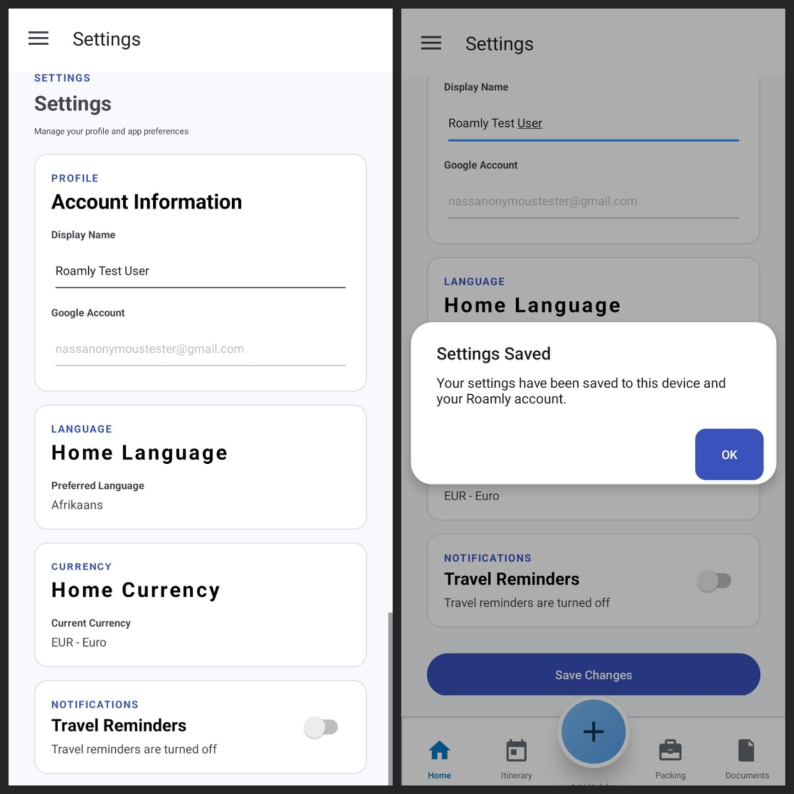

*Figure 6: Roamly confirming that the modified Settings were saved to the device and the authenticated Roamly account.*

________________________________________

## SETTINGS-02 - Settings Persistence After Restart

**Feature:** DataStore Settings persistence  
**Objective:** Verify that saved preferences remain available after navigation and after the application is closed and reopened.

**Test Data Verified:**

- Display Name: `Roamly Test User`
- Preferred Language: `Afrikaans`
- Home Currency: `ZAR - South African Rand`
- Travel Reminders: `Off`

**Test Steps:**

1. Configure the Settings values shown above
2. Save the Settings
3. Navigate away from Settings
4. Return to Settings and confirm the saved values
5. Close Roamly completely
6. Reopen the application
7. Return to Settings and confirm that the same values remain available

**Expected Result:**

The saved Settings should remain available after navigation and application restart.

**Actual Result:**

The display name, Afrikaans language preference, ZAR home currency and disabled Travel Reminders preference remained available after saving and reopening the Settings screen.

**Status:** PASS

**Evidence Screenshot:**

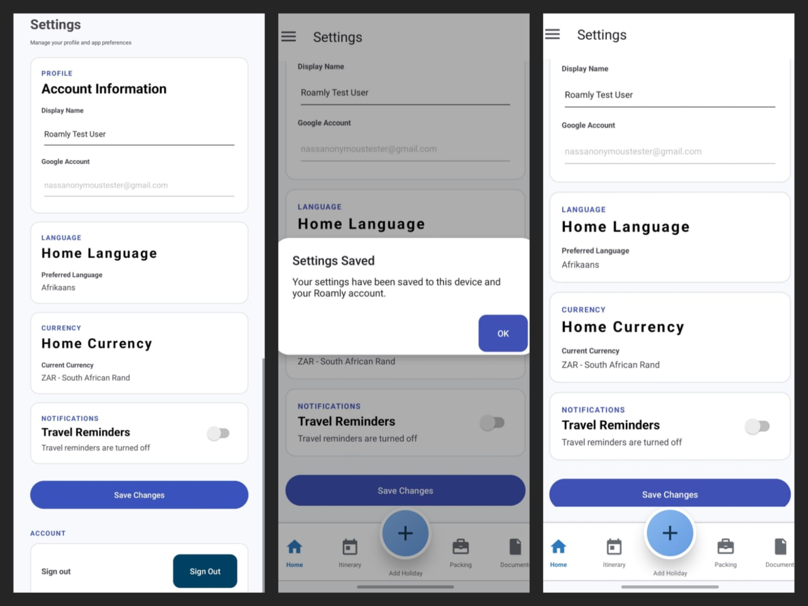

*Figure 7: Settings persistence evidence showing the saved values, the successful-save confirmation and the same stored preferences remaining available afterwards.*

________________________________________

## SETTINGS-03 - Saved Home Currency Integration

**Feature:** Settings and Currency Converter integration  
**Objective:** Verify that the Home Currency saved in Settings is automatically used as the source currency in the Currency Converter.

**Preconditions:**

- Home Currency is saved as `ZAR - South African Rand`

**Test Steps:**

1. Save ZAR as the Home Currency in Settings
2. Open the Currency Converter
3. Observe the source currency
4. Verify that a different destination currency can be selected

**Expected Result:**

The Currency Converter should automatically use ZAR as the source currency.

**Actual Result:**

The Currency Converter opened with `ZAR - South African Rand` as the source currency and `EUR - Euro` as the destination currency.

**Status:** PASS

**Evidence Screenshot:**

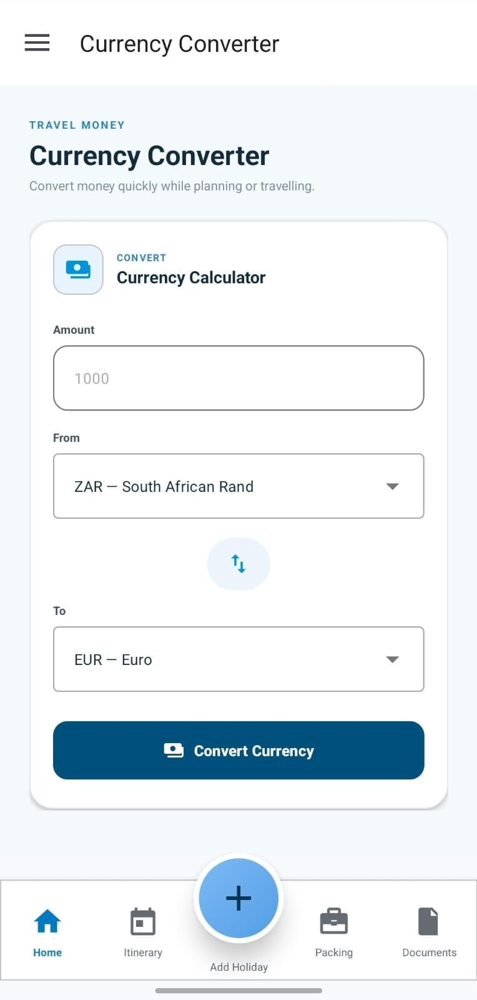

*Figure 8: Currency Converter automatically using the ZAR Home Currency saved in Settings.*

________________________________________

## SETTINGS-04 - Automated Settings Tests

**Feature:** Settings persistence and language mapping  
**Objective:** Verify Settings persistence and language-mapping logic through automated unit tests.

**Test Command:**

```powershell
.\gradlew.bat :app:testDebugUnitTest --tests "com.example.roamly.data.settings.SettingsPreferencesRepositoryTest" --tests "com.example.roamly.data.settings.SettingsLanguageMapperTest"
```

**Expected Result:**

All Settings persistence and language-mapping tests should pass.

**Actual Result:**

The Settings-specific automated test suite completed successfully with 8 tests, 0 failures and a 100% success rate.

**Status:** PASS

**Evidence Screenshot:**

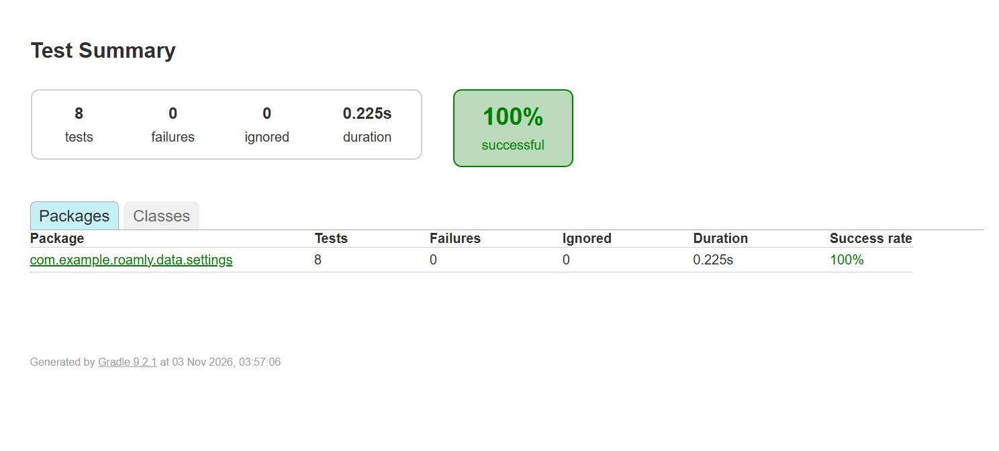

*Figure 9: Gradle test report confirming 8 Settings tests completed with 0 failures, 0 ignored tests and a 100% success rate.*

________________________________________

## API-01 - Authenticated REST API Round Trip

**Feature:** Custom REST API integration  
**Objective:** Verify that authenticated holiday data created in the Android application is processed by the Roamly backend and persisted in Azure SQL.

**Why this test matters:**

An app-side screenshot alone only proves that data is visible in the interface. For the Final POE integration requirement, the same test record must also be visible in the cloud data layer so that the Android → API → database round trip can be demonstrated.

**Test Data:**

- Holiday Title: `Final POE Test`
- Trip Type: `Leisure`
- Destination: `Cape Town, South Africa`
- Dates: `13 Nov - 20 Nov 2026`

**Test Steps:**

1. Authenticate in Roamly
2. Create the Final POE holiday using the test data above
3. Save the holiday
4. Confirm that the holiday appears in the Android application
5. Query the Azure SQL Holiday data for the matching Final POE record
6. Compare the visible cloud values with the Android record

**Expected Result:**

The authenticated API request should be accepted, the holiday should remain visible in Roamly and a matching cloud record should be available in Azure SQL.

**Actual Result:**

The Final POE holiday was displayed successfully in the Android application with the Leisure trip type, Cape Town destination and 13–20 November travel dates.

Azure SQL then returned the corresponding Final POE holiday record. The cloud evidence shows the matching South Africa / Cape Town values together with the 2026-11-13 start date and 2026-11-20 end date. The database title contains the same Final POE test identifier used to locate the record.

The combined Android and Azure screenshots therefore provide evidence of the application-side record and the matching cloud persistence required for the REST API round-trip test.

**Status:** PASS

**Evidence Screenshots:**

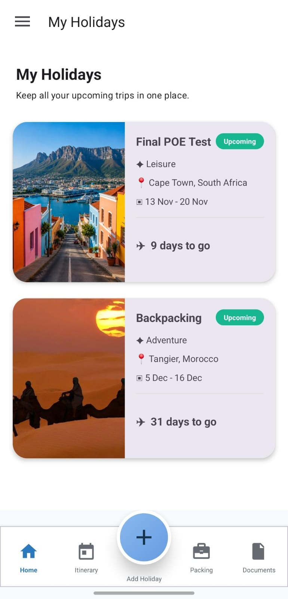

*Figure 10: The Final POE Cape Town holiday displayed in Roamly after creation. This provides the Android-side record used for the API round-trip verification.*

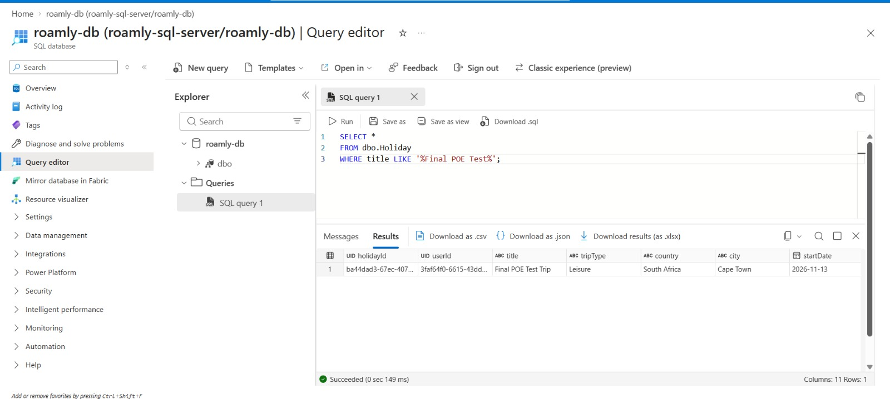

*Figure 11: Azure SQL query results showing the matching Final POE holiday record with Leisure trip type, South Africa country, Cape Town city and the expected start date.*

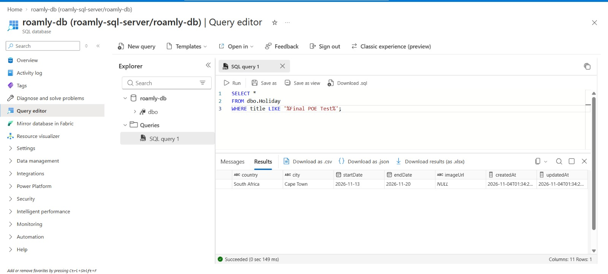

*Figure 12: The same Azure SQL record showing the expected 13 November 2026 start date and 20 November 2026 end date, completing the cloud-side comparison.*

________________________________________

## OFFLINE-01 - Supported Action While Offline

**Feature:** Room offline persistence  
**Objective:** Verify that supported Packing functionality can be used while network connectivity is unavailable.

**Test Data:**

- Packing List: `Offline Test Packing`
- Description: `Testing the 'Offline' feature`
- Packing Items: `Offline Test Passport` and `Offline Test Hotel Accommodation`

**Test Steps:**

1. Open Roamly while online and allow the application to load
2. Open Packing
3. Disable network connectivity on the physical Android device
4. Create `Offline Test Packing`
5. Add the two identifiable test items
6. Mark one item as packed
7. Verify that the list and item state remain visible while offline

**Expected Result:**

The supported packing data should be created locally and remain visible while the device is offline.

**Actual Result:**

`Offline Test Packing` was created while the device was offline. Both test items remained visible locally, one item could be marked as packed and the packing list displayed `1 of 2 packed`.

**Status:** PASS

**Evidence Screenshot:**

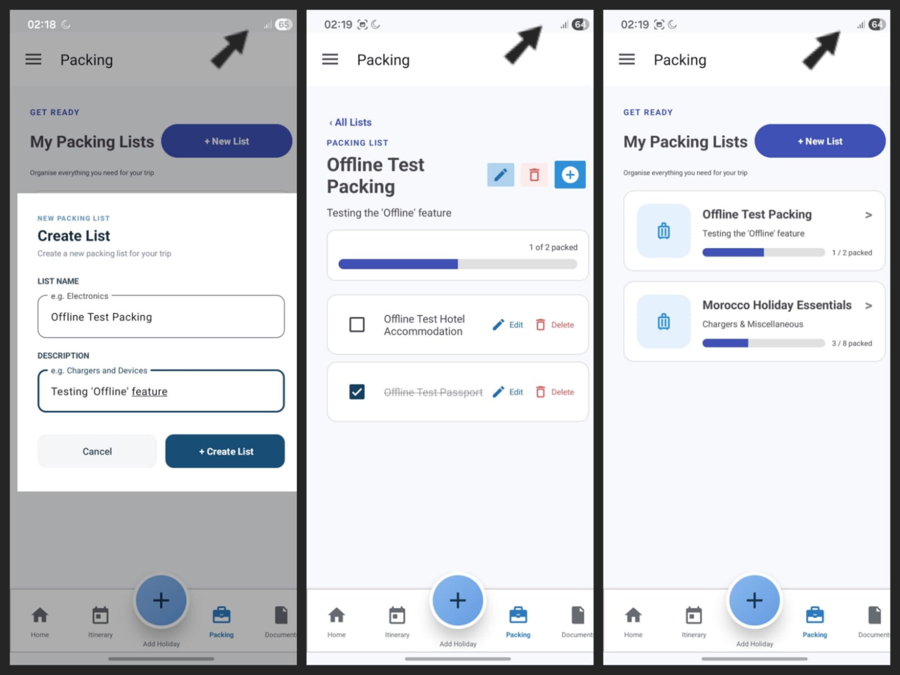

*Figure 11: Packing-list creation and item state successfully retained in Roamly while the physical device was offline.*

________________________________________

## SYNC-01 - Application State After Network Reconnection

**Feature:** Offline-to-cloud synchronisation  
**Objective:** Verify that data created while offline remains available after reconnection and is synchronised to the cloud without losing the recorded item state.

**Why this test matters:**

Offline availability alone does not prove synchronisation. This test therefore uses both the physical-device result and a matching Azure SQL query so that the transition from local Room data to cloud-backed data can be demonstrated.

**Preconditions:**

- OFFLINE-01 has completed successfully
- `Offline Test Packing` exists locally with two test items
- One item has been marked as packed

**Test Steps:**

1. Restore mobile data or Wi-Fi
2. Allow Roamly's automatic synchronisation process to run
3. Reopen or refresh Packing
4. Confirm that `Offline Test Packing` remains available
5. Verify that its packed/unpacked state remains correct
6. Query the Azure SQL Packing tables for the matching list and items

**Expected Result:**

The offline-created data should remain available after reconnection and the same records should be present in the cloud without being lost or duplicated.

**Actual Result:**

After connectivity was restored, `Offline Test Packing` remained visible in Roamly with the `1 / 2 packed` state intact.

The Azure SQL verification returned the matching `Offline Test Packing` list together with `Offline Test Hotel Accommodation` and `Offline Test Passport`. The stored `IsPacked` values also matched the physical-device test: the passport item was stored as packed while the hotel-accommodation item remained unpacked.

This confirms both local retention after reconnection and successful offline-to-cloud synchronisation.

**Status:** PASS

**Evidence Screenshots:**

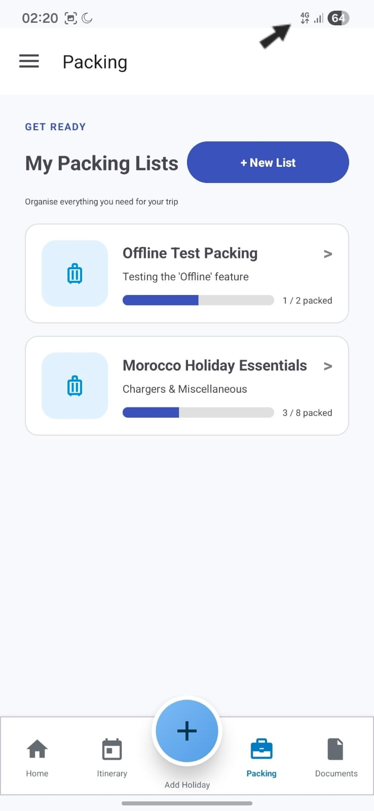

*Figure 14: The offline-created Packing list remaining available in Roamly after mobile connectivity was restored, with the original packing progress still visible.*

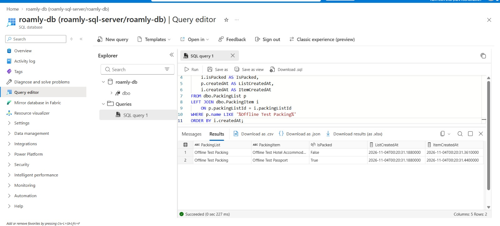

*Figure 15: Azure SQL results showing the synchronised Offline Test Packing list and both test items, including their matching packed and unpacked states.*

________________________________________

## NOTIFY-01 - Real-Time Push Notification

**Feature:** Firebase Cloud Messaging  
**Objective:** Verify that Firebase Cloud Messaging can deliver a Roamly push notification to the physical Android device.

**Why this test matters:**

The Final POE requires real-time push notifications. The final evidence therefore records the notification as it appeared in Android's notification shade rather than relying only on Firebase configuration or source-code evidence.

**Test Steps:**

1. Ensure Android notification permission is enabled for Roamly
2. Ensure the device has internet connectivity
3. Send the Roamly test message through Firebase Cloud Messaging
4. Open the Android notification shade
5. Verify the notification title and message

**Expected Result:**

A Roamly push notification should be received and displayed by Android.

**Actual Result:**

The physical Android device received a notification titled **Roamly - Test Notification** with the message **Your Roamly push notifications are working successfully!**

The notification was displayed using the Roamly application icon inside Android's notification shade. This confirms that the Firebase message reached the device and was surfaced by the Android notification system.

**Status:** PASS

**Evidence Screenshot:**

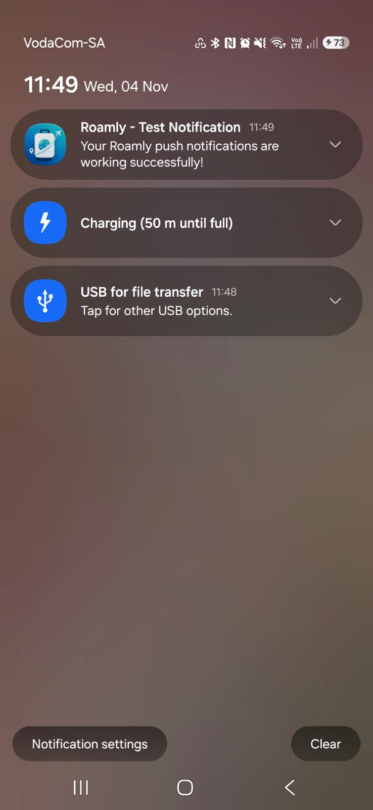

*Figure 16: Android notification shade showing the Roamly Firebase Cloud Messaging test notification received on the physical device. The visible Roamly title, icon and test message provide direct delivery evidence.*

________________________________________

## LANGUAGE-01 - Language Switching

**Feature:** Multi-language support  
**Objective:** Verify that Roamly can switch the visible interface to a supported South African language.

**Final Languages Implemented:**

- English
- Afrikaans
- isiZulu
- isiXhosa

**Language Tested for Final Evidence:** Afrikaans

**Why this test matters:**

The final project contains separate Android string-resource sets for all four supported languages. This test checks the user-facing result by confirming that the selected locale affects multiple interface elements rather than only changing one isolated label.

**Test Steps:**

1. Open Settings
2. Select Afrikaans
3. Save the preference
4. Navigate to the Add Holiday interface
5. Verify translated headings, instructions, labels, buttons and bottom-navigation items

**Expected Result:**

The visible Roamly interface should use the selected Afrikaans resources across the tested screen.

**Actual Result:**

The Add Holiday screen changed to Afrikaans and displayed translated interface text such as **Voeg vakansie by**, **Beplan jou volgende reis**, **Vakansieprent**, **Kies omslagprent**, **Reisinligting** and the translated bottom navigation.

The screenshot contains several independent interface elements, providing stronger evidence of application-wide localisation than a single translated string.

**Status:** PASS

**Evidence Screenshot:**

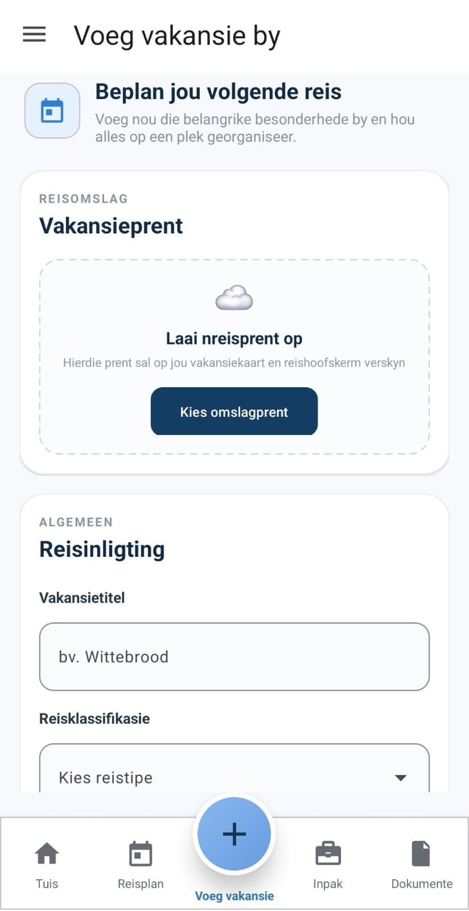

*Figure 17: Final Add Holiday interface displayed in Afrikaans. The translated page heading, explanatory text, field labels, action button and bottom-navigation labels demonstrate that the selected locale is being applied across the screen.*

________________________________________

## LANGUAGE-02 - Language Persistence After Restart

**Feature:** Multi-language persistence  
**Objective:** Verify that the selected language remains active after Roamly is closed and reopened.

**Why this test matters:**

A successful language switch is only temporary if the preference is lost when the application closes. This test therefore verifies the persistence behaviour expected from the Settings and locale implementation.

**Test Steps:**

1. Select and save Afrikaans as the preferred application language
2. Close Roamly completely
3. Reopen the application
4. Authenticate if required
5. Navigate to the Itinerary screen
6. Confirm that the Afrikaans locale remains active

**Expected Result:**

The selected Afrikaans locale should still be active after application restart.

**Actual Result:**

After reopening Roamly, the Itinerary screen remained in Afrikaans. The interface displayed translated text including **Reisplan**, **My Reisplanne**, **Geselekteerde Reis**, **Daaglikse Plan**, **Wysig** and the translated bottom-navigation items.

This confirms that the language selection was not limited to the original screen and remained active after the application was reopened.

**Status:** PASS

**Evidence Screenshot:**

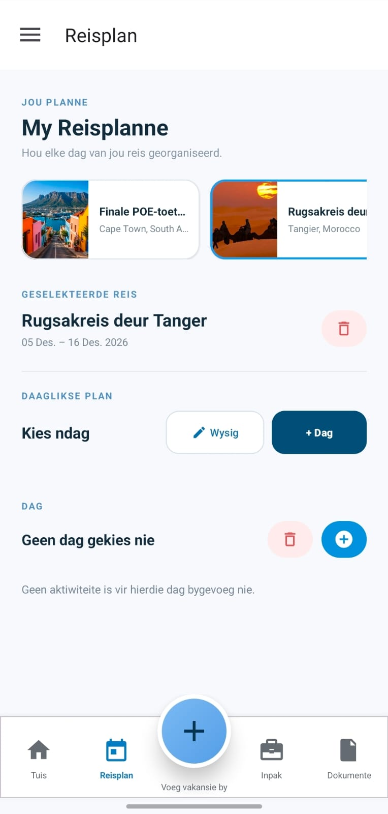

*Figure 18: Roamly Itinerary interface still displayed in Afrikaans after the application was reopened, demonstrating persistence of the selected language across an application restart.*

________________________________________

## BLOB-01 - Azure Blob Travel Document Storage

**Feature:** Travel Documents / Azure Blob Storage  
**Objective:** Verify the complete travel-document flow from Android upload through metadata persistence to the stored Azure Blob object.

**Test Data:**

- Document Name: `Boarding Pass`
- Document Type: `Flight`
- File: `Morocco Trip - Boarding Pass.pdf`
- Notes: `Boarding Pass for outbound flight`

**Why this test matters:**

The Final POE separates structured document metadata from the actual uploaded file. The final verification therefore checks all three parts of the flow: the Android interface, Azure SQL metadata and the Azure Blob object.

**Test Steps:**

1. Authenticate in Roamly
2. Open Travel Documents
3. Select **Upload Document**
4. Enter the test document details
5. Select `Morocco Trip - Boarding Pass.pdf`
6. Upload the document
7. Confirm that the document appears in Roamly
8. Query Azure SQL for the matching TravelDocument metadata
9. Open the matching object in the Azure Blob Storage `travel-documents` container

**Expected Result:**

The Travel Document should appear in Roamly, its metadata should be persisted and the actual PDF should exist as a stored Blob object.

**Actual Result:**

Roamly uploaded the Boarding Pass successfully and displayed it in the Travel Documents list with the Flight document type and upload confirmation.

Azure SQL contained the corresponding TravelDocument metadata, including the Boarding Pass name, Flight type, PDF file information and stored file URL.

Azure Blob Storage also contained the matching PDF object. The Blob properties identified it as an `application/pdf` block blob with a size of approximately 112.5 KiB and server-side encryption enabled.

Together, these results verify the complete application → backend metadata → Blob Storage workflow.

**Status:** PASS

**Evidence Screenshots:**

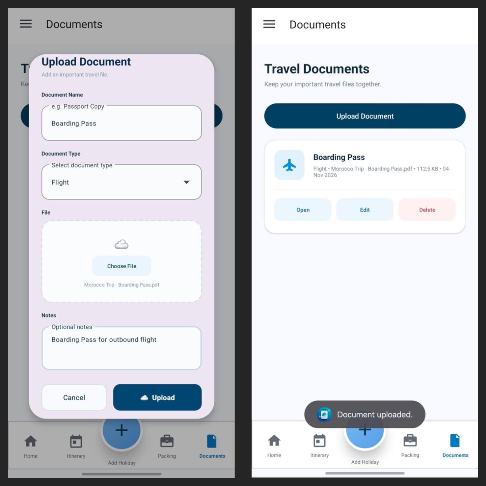

*Figure 19: Roamly Travel Documents showing the Boarding Pass upload form and the successfully uploaded document record in the Android interface.*

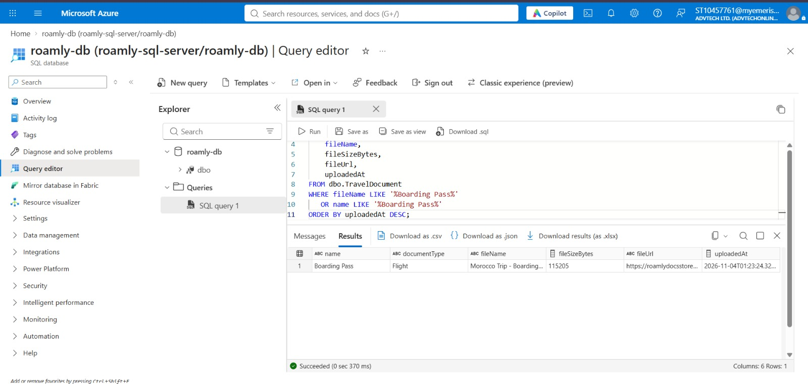

*Figure 20: Azure SQL result showing the matching Boarding Pass TravelDocument metadata, including document type, file name, file size, stored URL and upload timestamp.*

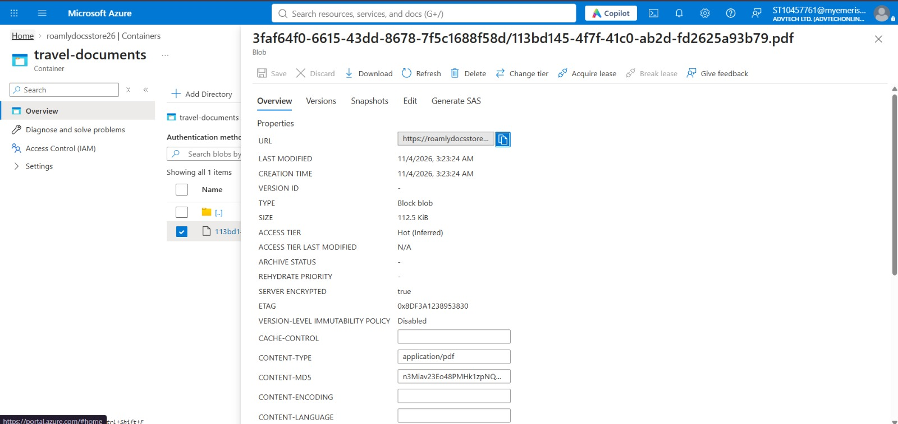

*Figure 21: Matching PDF object in the Azure Blob Storage travel-documents container. The properties show the stored block blob, PDF content type, file size and server-encrypted status.*

________________________________________

## NOSQL-01 - NoSQL Data Write and Read

**Feature:** Azure Table Storage travel notes  
**Objective:** Verify that the Final POE NoSQL component can persist and expose Roamly travel-note data.

**Final Implementation:**

Roamly uses **Azure Table Storage** for the NoSQL requirement. The backend creates and accesses authenticated travel notes through the `RoamlyTravelNotes` table.

Each note can contain:

- Title
- Content
- Category
- Tags
- Created timestamp
- Updated timestamp

The authenticated user ID is used as part of the storage partitioning strategy so that the backend can work with the correct user's notes.

**Test Steps:**

1. Use the implemented travel-notes backend integration to create the Final POE test note
2. Open the Azure Storage account
3. Open **Storage browser → Tables → RoamlyTravelNotes**
4. Locate the `POE NoSQL Test` entity
5. Verify that the note fields are stored and readable

**Expected Result:**

The travel note should be stored successfully in Azure Table Storage and the stored properties should remain readable from the table.

**Actual Result:**

Azure Storage Browser displayed the `POE NoSQL Test` entity inside the `RoamlyTravelNotes` table.

The stored record included the travel-note content, `general` category, tags such as `POE`, `Testing` and `Azure`, together with created and updated timestamps. The visible PartitionKey and RowKey also demonstrate the key-based storage model used by Azure Table Storage.

The result confirms successful NoSQL persistence and retrieval of the implemented travel-note data.

**Status:** PASS

**Evidence Screenshots:**

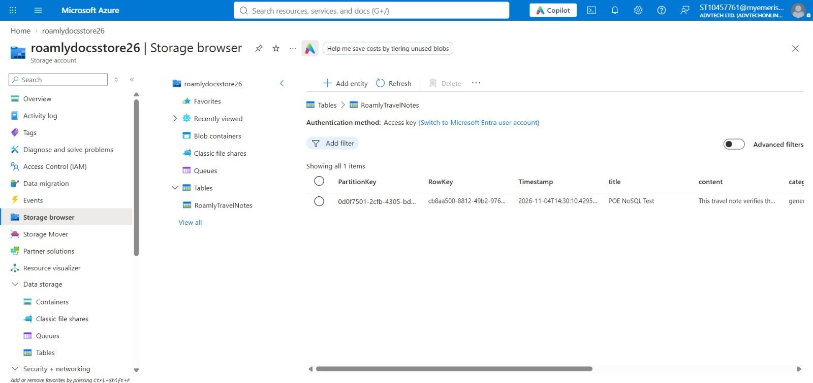

*Figure 22: Azure Storage Browser showing the POE NoSQL Test entity in the RoamlyTravelNotes table, including its key fields, title and stored content.*

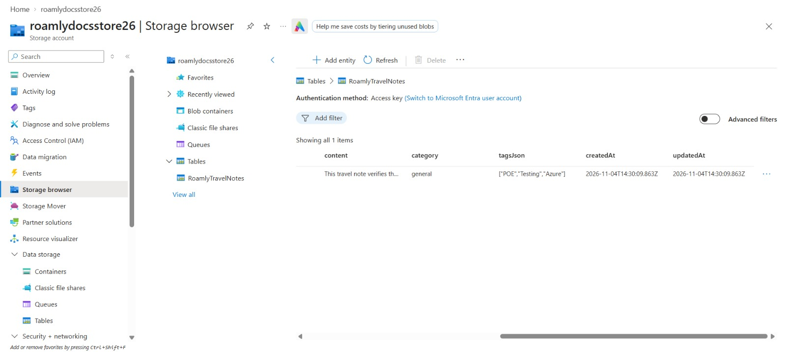

*Figure 23: Additional fields from the same Azure Table Storage entity, including category, tags and created/updated timestamps used by the Roamly travel-note implementation.*

________________________________________

## FEATURE4-01 - User-Defined Feature 4: Travel Management Toolkit

**Feature:** Travel Management Toolkit  
**Objective:** Verify the custom packing-list functionality identified as part of User-Defined Feature 4.

**Test Data:**

Packing List: `Greece Holiday Essentials`

Items include:

- Travel adapter
- Medication
- Passport
- Hotel confirmation
- Comfy walking shoes
- Sunglasses
- Additional packing items used to complete the eight-item list

**Test Steps:**

1. Open Packing
2. Create `Greece Holiday Essentials`
3. Add multiple realistic packing items
4. Mark selected items as packed
5. Verify that packed and unpacked states are displayed
6. Verify that the progress indicator updates

**Expected Result:**

Packing-list creation, packing-item management, packed/unpacked state and progress calculation should operate correctly.

**Actual Result:**

The packing list was created successfully, multiple items were added, packed/unpacked state was displayed and the progress calculation updated to `3 of 8 packed`.

**Status:** PASS

**Evidence Screenshot:**

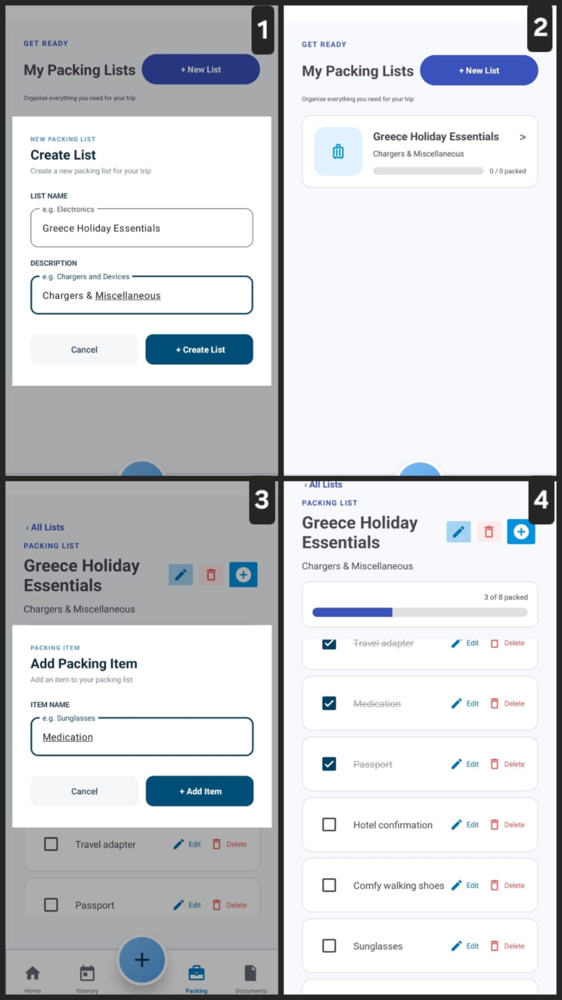

*Figure 14: Four-stage evidence showing creation of the Greece Holiday Essentials packing list, addition of items and calculated packing progress.*

________________________________________

## FEATURE5-01 - User-Defined Feature 5: Automated Reminders and Countdowns

**Feature:** Automated Travel Reminders and Countdowns  
**Objective:** Verify the reminder and holiday-countdown functionality identified as User-Defined Feature 5.

**Reminder Test Data:**

- Title: `Online Flight Check-in`
- Description: `Check-in before airport arrival`
- Holiday: `Backpacking through Tangier`
- Date: `04 Dec 2026`
- Time: `23:00`
- Enabled: On

**Test Steps:**

1. Open Notifications & Reminders
2. Create the test reminder
3. Save the reminder
4. Confirm that its title, date/time, associated holiday, description and enabled state are displayed
5. Open the My Holidays screen
6. Confirm that the upcoming holiday card displays a countdown

**Expected Result:**

The reminder should save correctly and the relevant future holiday should display a calculated countdown.

**Actual Result:**

The `Online Flight Check-in` reminder was created and displayed with its date/time, associated `Backpacking through Tangier` holiday, description and enabled state. The Backpacking holiday card separately displayed `31 days to go`.

**Status:** PASS

**Evidence Screenshots:**

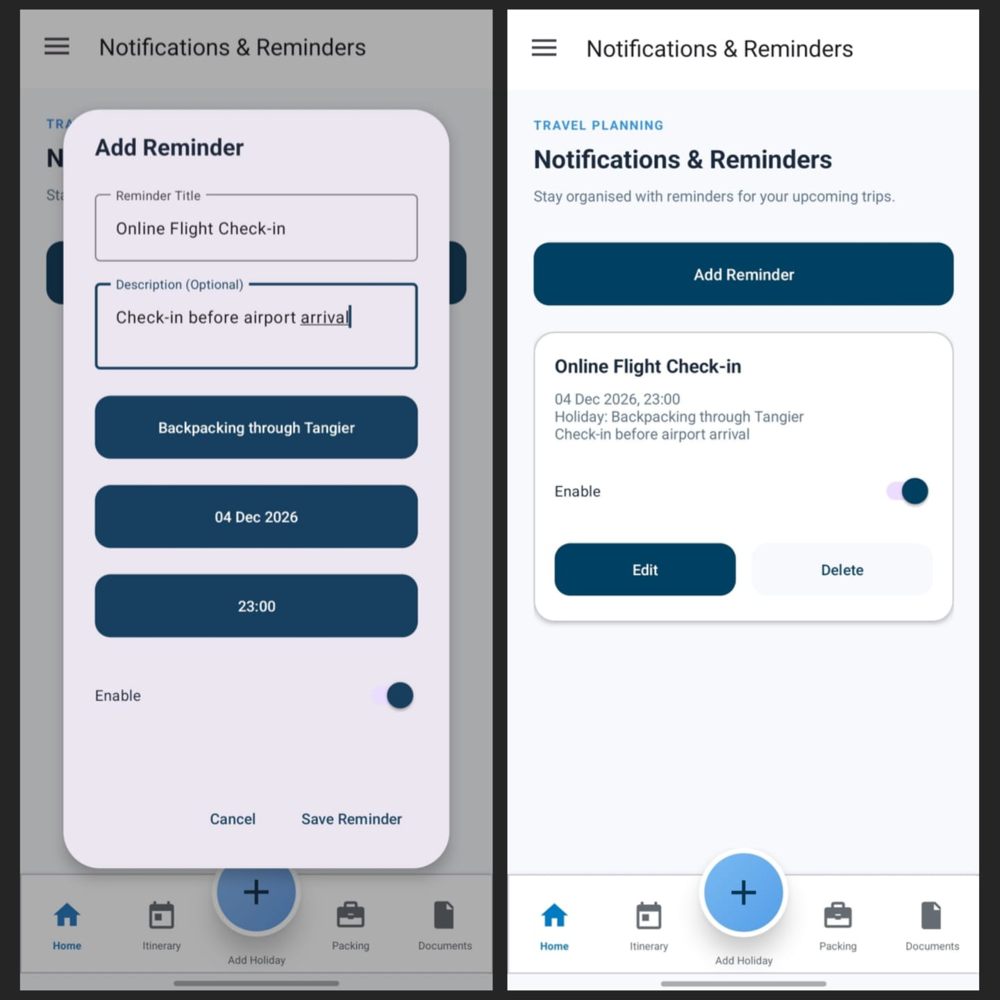

*Figure 15: Creation and saved display of the Online Flight Check-in travel reminder.*

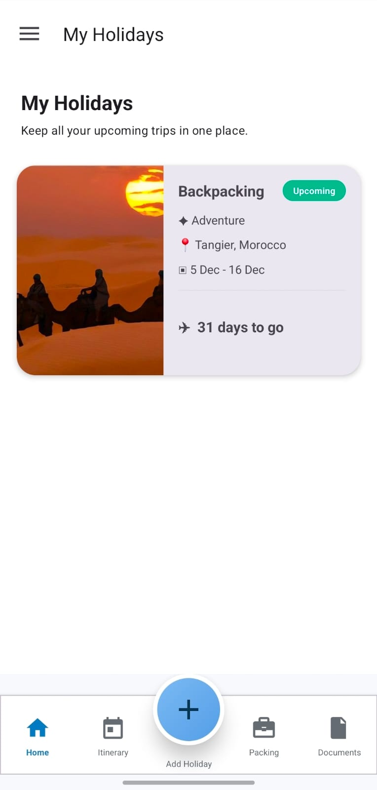

*Figure 16: Backpacking holiday card displaying the calculated 31-day countdown.*

________________________________________

## CI-01 - GitHub Actions Build and Test Workflow

**Feature:** Continuous Integration  
**Objective:** Verify that the final repository automatically executes the configured Android unit-test task and Android build task outside the developer's local machine.

**Why this test matters:**

Local `BUILD SUCCESSFUL` results are useful during development, but continuous integration verifies that the committed repository can repeat the test/build process in a clean GitHub-hosted environment.

**Workflow Configuration:**

The final workflow is stored in:

```text
.github/workflows/android-tests.yml
```

It runs when:

- Code is pushed to `main`
- A pull request targets `main`

The final workflow includes:

```text
./gradlew testDebugUnitTest
./gradlew assembleDebug
```

**Test Steps:**

1. Merge the final tested project changes into `main`
2. Open the repository's **Actions** tab
3. Open the latest Android Tests run on `main`
4. Open the `test` job
5. Verify that **Run Android unit tests** has a successful status
6. Verify that **Build Android debug APK** has a successful status
7. Confirm that the complete workflow run is green

**Expected Result:**

The final workflow should complete successfully and both the automated unit-test task and Android build task should pass.

**Actual Result:**

The final `main` workflow completed successfully after the latest integrated changes. GitHub Actions displayed green successful status for **Run Android unit tests** and **Build Android debug APK** within the same job.

This provides repository-level evidence that the final committed project can execute its configured Android unit tests and compile the debug application in the GitHub Actions environment.

**Status:** PASS

**Evidence Screenshot:**

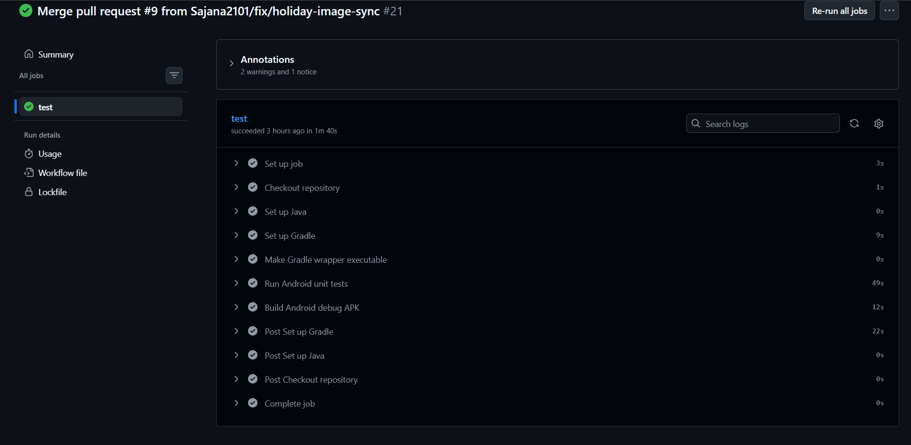

*Figure 27: Final Android Tests workflow on `main` showing the complete successful job. Both Run Android unit tests and Build Android debug APK are visible with successful status, confirming automated test and build verification.*

________________________________________

## BUILD-01 - Android Application Build

**Feature:** Application compilation  
**Objective:** Verify that the Android application compiles successfully.

**Test Command:**

```powershell
.\gradlew.bat :app:assembleDebug
```

**Expected Result:**

Gradle should complete the build successfully and generate the debug APK.

**Actual Result:**

Gradle completed successfully and generated the debug APK.

**Status:** PASS

________________________________________

## DEVICE-01 - Physical Device Execution

**Feature:** Physical Android execution  
**Objective:** Verify that Roamly installs and runs successfully on a physical Android device.

**Test Steps:**

1. Install the generated Roamly APK on the physical Android device
2. Launch Roamly
3. Authenticate
4. Navigate through the major application areas
5. Confirm normal operation without a critical runtime crash

**Expected Result:**

Roamly should install, launch and operate on the physical Android device.

**Actual Result:**

Roamly installed and ran successfully on the physical Android test device. Google SSO, Settings, Currency Converter, Packing, Reminders and other tested application areas were exercised on the same physical-device installation.

**Status:** PASS

**Supporting Screenshot:**


*Figure 17: Roamly Home displayed on the physical Android test installation after authentication. The final demonstration video provides the primary visual proof that the application is running live on a physical mobile phone.*

________________________________________

## REGRESSION-01 - Final Integrated Regression Review

**Objective:** Verify that the final merged project remained buildable and that the advanced integrations added near the end of the Final POE did not introduce a critical regression into the verified application.

**Purpose of the review:**

Regression testing focuses on functionality that was already working before the final merges. Rather than creating a new feature, the review checks whether integration work has unintentionally broken previously verified behaviour.

**Areas Reviewed:**

- Google SSO
- Biometric authentication
- Holiday management
- Itinerary management
- Packing
- Travel Documents
- Currency Converter
- Settings
- Reminders
- Firebase notifications
- Offline operation
- Reconnection synchronisation
- Multi-language support
- User-Defined Feature 4
- User-Defined Feature 5
- Main navigation
- Final build and automated test workflow

**Verification Approach:**

The regression review combined the final physical-device evidence with the final merged `main` branch and the latest successful GitHub Actions run.

Particular attention was given to the integrations added or changed closest to submission, including biometric authentication, multilingual functionality, notification delivery, synchronisation and the final holiday-image synchronisation fix.

**Expected Result:**

The final merged application should remain buildable and the previously verified Final POE areas should continue to operate without a critical integration failure.

**Actual Result:**

The latest merged `main` branch completed the GitHub Actions Android unit-test and debug-build tasks successfully.

Final physical-device evidence also confirmed the native biometric prompt and persisted Afrikaans interface after the multilingual merge, while the existing Final POE evidence continued to verify authentication, Settings, API/cloud persistence, Packing, offline synchronisation, FCM notifications, Travel Documents and the user-defined features.

No critical regression was identified in the final integrated verification.

**Status:** PASS

________________________________________

# 8. Automated Test Commands

The following commands are used to verify the Android project locally:

```powershell
.\gradlew.bat :app:testDebugUnitTest
```

```powershell
.\gradlew.bat :app:assembleDebug
```

Settings-specific automated tests:

```powershell
.\gradlew.bat :app:testDebugUnitTest --tests "com.example.roamly.data.settings.SettingsPreferencesRepositoryTest" --tests "com.example.roamly.data.settings.SettingsLanguageMapperTest"
```

At the time of Settings implementation verification:

- The Settings-specific suite completed 8 tests with 0 failures
- The full `:app:testDebugUnitTest` task completed successfully
- The `:app:assembleDebug` task completed successfully

________________________________________

# 9. Evidence Register

The evidence register provides a quick index of the screenshots used throughout the report. Each file is stored once under `docs/evidence/` and is then embedded in the relevant test case, which avoids keeping duplicate image files in different sections of the repository.

| Evidence File | Related Test | What the Evidence Demonstrates |
|---|---|---|
| `google-sso-01.png` | AUTH-01 | Roamly Google Sign-In entry point |
| `google-sso-02.png` | AUTH-01 | Secure Google authentication processing |
| `google-sso-03.png` | AUTH-01 | Android Google account chooser |
| `mainpage-after-login-01.png` | AUTH-01 / DEVICE-01 | Authenticated Roamly interface on the physical device |
| `biometric-native-prompt-photo.png` | BIOMETRIC-01 | Native protected Android fingerprint prompt |
| `settings-save-success.png` | SETTINGS-01 | Successful Settings save confirmation |
| `settings-persistence.png` | SETTINGS-02 | Saved Settings retained after reopening |
| `currency-home-preference.png` | SETTINGS-03 | Saved Home Currency used in Currency Converter |
| `settings-unit-tests.png` | SETTINGS-04 | Eight Settings tests with 100% success |
| `api-round-trip-app.png` | API-01 | Final POE holiday displayed in Android |
| `api-round-trip-cloud-01.png` | API-01 | Matching Azure SQL holiday values |
| `api-round-trip-cloud-02.png` | API-01 | Matching Azure SQL start/end dates |
| `offline-action.png` | OFFLINE-01 | Packing data created and retained while offline |
| `sync-after-reconnect-app.png` | SYNC-01 | Offline data still visible after reconnection |
| `sync-after-reconnect-cloud.png` | SYNC-01 | Matching Packing list/items in Azure SQL after sync |
| `fcm-notification.png` | NOTIFY-01 | Delivered Roamly FCM notification |
| `language-switch.png` | LANGUAGE-01 | Afrikaans Add Holiday interface |
| `language-persistence.png` | LANGUAGE-02 | Afrikaans still active after reopening |
| `blob-document-app.png` | BLOB-01 | Boarding Pass upload in Roamly |
| `blob-metadata-cloud.png` | BLOB-01 | Matching TravelDocument metadata in Azure SQL |
| `blob-storage-cloud.png` | BLOB-01 | Matching PDF object in Azure Blob Storage |
| `nosql-read-write.png` | NOSQL-01 | POE NoSQL Test entity in Azure Table Storage |
| `nosql-read-write-details.png` | NOSQL-01 | Category, tags and timestamps for the NoSQL record |
| `user-defined-feature-4.png` | FEATURE4-01 | Packing toolkit and progress calculation |
| `reminder-feature.png` | FEATURE5-01 | Saved travel reminder |
| `holiday-countdown.png` | FEATURE5-01 | Calculated future-trip countdown |
| `github-actions-success.png` | CI-01 | Successful automated unit-test and Android build job |
| `architecture-overview.png` | README architecture | Core online/offline architecture overview |

________________________________________

# 10. Final Test Sign-Off

The checklist below is used as the final documentation sign-off. It summarises the areas for which implementation and supporting verification are now available.

- [x] Final project builds successfully
- [x] Automated Android tests pass
- [x] GitHub Actions final workflow succeeds
- [x] Application launches successfully on a physical Android device
- [x] Google SSO works
- [x] Native biometric authentication is visually verified
- [x] Settings save and persist
- [x] REST API round-trip evidence is available
- [x] Offline Packing is verified
- [x] Cloud synchronisation after reconnection is verified
- [x] Real-time FCM notification delivery is verified
- [x] Multi-language switching is verified
- [x] Language persistence after restart is verified
- [x] Azure Blob Storage is verified
- [x] Azure Table Storage NoSQL persistence is verified
- [x] User-Defined Feature 4 is verified
- [x] User-Defined Feature 5 is verified
- [x] Final integrated regression review is complete
- [x] Evidence screenshots are stored under `docs/evidence/`

________________________________________

## Testing Conclusion

The Final POE testing process combined automated verification, physical-device testing and direct cloud-side evidence so that important requirements were not assessed from the Android interface alone.

The final evidence verifies the complete authentication flow, native biometric invocation, DataStore persistence, Home Currency integration, authenticated REST API persistence, Room offline behaviour, WorkManager reconnection synchronisation, Firebase push delivery, four-language localisation, Azure Blob Storage, Azure Table Storage, both user-defined features and the final GitHub Actions test/build process.

Where a feature depended on a cloud service, the report deliberately includes both the app-side result and the corresponding Azure evidence. This is particularly visible in the API round-trip, offline synchronisation and Travel Documents tests.

The final integrated review did not identify a critical regression in the verified Final POE areas. The completed report therefore provides a consolidated record of the application's final functional, integration and DevOps verification.
